# KẾ HOẠCH TRIỂN KHAI HỆ THỐNG QUẢN LÝ TỔ HỢP ĐA THỂ THAO

**Phiên bản 1.0** · Ngày lập: 06/10/2026 · Phạm vi: 1 cơ sở · Đội thực hiện: 7 thành viên · Triển khai: 100% cloud

> Tài liệu tổng hợp toàn bộ yêu cầu đã thu thập trong buổi làm việc: kiến trúc hệ thống, đặc tả chi tiết từng chức năng, thiết kế dữ liệu, kế hoạch theo giai đoạn, phân bổ khối lượng cho 7 thành viên, kiểm thử, vận hành, rủi ro và chi phí. Những điểm **chưa được chốt** nằm ở mục 2 (giả định cần xác nhận) và đã được gán giá trị mặc định để đội có thể bắt đầu.

## Mục lục

1. Tổng quan dự án
2. Giả định và các điểm cần xác nhận
3. Kiến trúc hệ thống
4. Đặc tả chi tiết chức năng (module M02 đến M22)
5. Thiết kế dữ liệu (sơ đồ ER, collection, chỉ mục, giao dịch)
6. Danh mục API chính
7. Kế hoạch theo giai đoạn
8. Phân bổ công việc cho 7 thành viên
9. Kế hoạch kiểm thử và chất lượng
10. Triển khai, vận hành, đào tạo
11. Rủi ro và biện pháp giảm thiểu
12. Ước lượng khối lượng và chi phí
13. Phụ lục

---

## 1. Tổng quan dự án

### 1.1 Mục tiêu

Xây dựng một hệ thống phần mềm duy nhất để vận hành toàn bộ tổ hợp: cho khách **đặt sân, mua thẻ gym, chơi game, đặt phòng riêng, mua hàng, đăng ký giải đấu**; cho nhân viên **thu ngân, check-in, quản lý kho, ca làm việc**; cho chủ và quản lý **cấu hình giá, theo dõi doanh thu và vận hành theo thời gian thực**.

### 1.2 Quy mô tài nguyên

| Khu | Số lượng | Ghi chú |
|---|---|---|
| Bóng đá | 8 sân 5 người | 6 sân thuộc **một cụm ghép được**: ghép thành 1 sân 11, hoặc 3 sân 7 (mỗi sân 7 = 2 sân 5), hoặc dùng riêng từng sân 5. 2 sân 5 còn lại độc lập |
| Tennis | 2 sân | Độc lập |
| Cầu lông | 2 sân | Độc lập |
| Bóng rổ | 2 sân | Độc lập |
| Gaming sảnh | 60 máy | Tính tiền theo giờ chơi, khách tự đăng nhập bằng tài khoản |
| Gaming phòng riêng | 10 phòng | Đặt trước theo khung giờ, tính riêng ngoài 60 máy sảnh |
| Phòng gym | 1 phòng | Tối đa **100 người** tập cùng lúc |

### 1.3 Bốn kênh sử dụng

| Kênh | Công nghệ | Người dùng |
|---|---|---|
| Website khách hàng | Next.js | Khách |
| App mobile iOS/Android | React Native | Khách |
| Phần mềm quầy (POS) | Ứng dụng web React | Thu ngân, lễ tân |
| Trang quản trị | Next.js | Chủ, quản lý, PT |

Ngoài ra có hai thành phần chạy tại cơ sở: **Gaming client** cài trên từng máy (C#/.NET) và **Bridge agent** tại quầy (đầu đọc thẻ, vân tay, máy quét QR, máy in).

### 1.4 Các quyết định đã chốt

| Hạng mục | Quyết định |
|---|---|
| Loại hệ thống | Phần mềm/app quản lý và đặt sân, dịch vụ |
| Quy mô | Một cơ sở duy nhất |
| Tài khoản khách | **Bắt buộc** có tài khoản mới sử dụng dịch vụ |
| Thanh toán | Tiền mặt tại quầy, chuyển khoản QR (VietQR), ví điện tử (MoMo, ZaloPay, VNPay). **Không** hỗ trợ thẻ quốc tế |
| Đặt sân online | Thanh toán **100% ngay khi đặt** |
| Hủy sân | Hủy **trước 24 giờ** được hoàn tiền |
| Đổi lịch | Được đổi sang khung giờ khác **nếu còn trống** |
| Giá thuê sân | Khác nhau giữa **giờ cao điểm và thấp điểm** (không phân biệt ngày thường, cuối tuần, lễ) |
| Gym | Thẻ thành viên theo tháng/quý/năm. **Không** bán vé lượt |
| Nghiệp vụ thẻ gym | Gia hạn (cộng dồn, ưu đãi gia hạn sớm), nâng cấp giữa chừng (bù chênh lệch). **Không** làm bảo lưu và chuyển nhượng |
| Giới hạn gym | Tối đa 100 người tập cùng lúc |
| Gaming | Phần mềm cài trên từng máy, tự mở/khóa máy, tự tính giờ và tiền; khách đăng nhập bằng tài khoản, nạp tiền vào ví; có đặt trước phòng riêng theo khung giờ |
| Ví nội bộ | Dùng cho **giờ chơi game, canteen, thuê sân, thuê dụng cụ**. **Không** dùng cho thẻ gym, sản phẩm thể thao, lớp học/PT |
| Check-in | QR trên app, lễ tân kiểm tra thủ công, thẻ từ/RFID/vân tay cho thành viên gym |
| Dịch vụ phụ | Canteen, cho thuê dụng cụ, bán sản phẩm thể thao, PT và lớp học theo buổi |
| PT | Nhân viên hưởng lương cố định (có thể thêm thưởng) |
| Vai trò nội bộ | Chủ cơ sở, quản lý, thu ngân/lễ tân, huấn luyện viên/PT |
| Ưu đãi | Mã giảm giá/voucher, gói combo, đặt sân cố định theo tuần/tháng cho đội nhóm. **Không** làm tích điểm |
| Sân ghép | Sân 11 ghép từ 6 sân 5; sân 7 ghép từ 2 sân 5; 2 sân 5 độc lập |
| Hóa đơn điện tử | Xuất tự động cho mọi giao dịch |
| Thông báo | Push trên app, Zalo ZNS/OA, email. **Không** dùng SMS |
| Báo cáo | Doanh thu theo khu, thống kê khách hàng, tồn kho/dụng cụ/đối soát ca, tỷ lệ lấp đầy và cao/thấp điểm |
| Giải đấu | Có tổ chức thường xuyên, gồm cả thể thao và esports, quản lý ngay trên hệ thống |
| Dữ liệu cũ | Không có, hệ thống hoàn toàn mới |
| Bảo mật | OTP 2 lớp, nhật ký thao tác nhân viên, sao lưu tự động hàng ngày kèm khôi phục, mã hóa dữ liệu nhạy cảm và tuân thủ quy định bảo vệ dữ liệu cá nhân, **chống trùng lặp khi đặt chỗ** |
| Hạ tầng | Toàn bộ trên cloud. Gaming client phải chịu được mất mạng tạm thời |
| Công nghệ | NestJS, MongoDB (replica set), Redis, Next.js, React Native, React (POS), C#/.NET (gaming client) |
| Thời gian | Từ 6 tháng trở lên, làm đầy đủ một lần |
| Đội | 7 thành viên |

### 1.5 Ngoài phạm vi phiên bản 1.0

- Nhiều cơ sở/chi nhánh (kiến trúc để chừa chỗ mở rộng, nhưng chưa làm phân quyền theo chi nhánh)
- Tích điểm, hạng thành viên
- Bảo lưu và chuyển nhượng thẻ gym, vé lượt gym
- Thanh toán thẻ ngân hàng/thẻ quốc tế online
- Quản lý thư viện game, cài đặt và cấp phép game trên máy
- Tính lương, bảo hiểm, thuế thu nhập nhân viên (chỉ ghi nhận thưởng và xuất dữ liệu cho kế toán)
- Gọi món từ máy gaming, giao đồ tận máy
- Quản lý camera, nhận diện khuôn mặt
- Giá phân biệt ngày thường, cuối tuần, ngày lễ
- Ví điện tử nội bộ có thể rút về ngân hàng tự động (rút ví chỉ thực hiện thủ công, quản lý duyệt)

---

## 2. Giả định và các điểm cần xác nhận

Những mục dưới đây **chưa được chốt trong buổi thu thập**. Đội sẽ làm theo giá trị mặc định cho đến khi chủ dự án xác nhận. Toàn bộ giá trị đều là **tham số cấu hình** trong trang quản trị, không viết cứng vào mã.

| Mã | Chủ đề | Giả định mặc định | Tác động nếu khác |
|---|---|---|---|
| A01 | Ô giờ đặt sân | Ô 30 phút, thời lượng đặt tối thiểu 60 phút, đặt trước tối đa 30 ngày | Đổi cấu trúc ô giờ, ảnh hưởng toàn bộ bảng `slots` |
| A02 | Hủy trong vòng 24 giờ | Hủy sau mốc 24 giờ **không hoàn tiền** | Thêm chính sách hoàn theo bậc |
| A03 | Đổi lịch | Đổi được trước giờ bắt đầu ít nhất 2 giờ, cùng loại sân, tối đa 2 lần/lượt đặt; bù hoặc hoàn phần chênh lệch giá | Điều chỉnh quy tắc M04 |
| A04 | Hoàn tiền về đâu | Mặc định hoàn **vào ví nội bộ** (tức thì). Hoàn về ngân hàng/ví điện tử gốc khi khách yêu cầu và quản lý duyệt | Cần tích hợp API hoàn tiền của từng cổng |
| A05 | Rút tiền khỏi ví | Khách gửi yêu cầu rút phần số dư còn lại, quản lý duyệt, chi tiền mặt hoặc chuyển khoản, có OTP | Nếu bỏ rút ví thì bỏ luồng này |
| A06 | Hóa đơn điện tử cho nạp ví | Nạp ví **chưa** xuất hóa đơn, xuất khi khách tiêu dùng dịch vụ. Cần kế toán xác nhận | Đổi thời điểm xuất hóa đơn, ảnh hưởng M08 |
| A07 | Phòng gaming riêng | Mỗi phòng có số máy cấu hình được; giá tính theo giờ phòng; đặt theo ô giờ giống sân; khách check-in bằng QR | Thay đổi mô hình giá phòng |
| A08 | Giá giờ chơi gaming | Theo nhóm máy (thường/VIP) và khung cao điểm/thấp điểm; tính theo phút, làm tròn lên | Đổi công thức tính tiền |
| A09 | Đặt sân cố định | Thanh toán trước theo kỳ (tháng hoặc tuần); ngày sân đóng cửa thì dời lịch hoặc hoàn tiền buổi đó | Đổi chu kỳ thu tiền |
| A10 | Nâng cấp thẻ gym | Phần giá trị còn lại của gói cũ (tính theo số ngày còn lại) được trừ vào giá gói mới; gói mới bắt đầu từ ngày nâng cấp; **không** cho hạ cấp | Đổi công thức |
| A11 | Quên check-out gym | Tự check-out sau 4 giờ kể từ lúc vào | Ảnh hưởng độ chính xác bộ đếm 100 người |
| A12 | OTP | Gửi qua Zalo ZNS, dự phòng email. Nhân viên luôn cần OTP khi đăng nhập; khách cần OTP khi đăng nhập thiết bị mới hoặc sau 30 ngày, và **luôn** cần khi nạp/rút ví | Chi phí ZNS và độ phiền cho khách |
| A13 | Ngôn ngữ | Tiếng Việt, mã nguồn sẵn khung đa ngôn ngữ | Thêm tiếng Anh tốn thêm công dịch và kiểm thử |
| A14 | Vân tay | Thẻ RFID là mặc định; vân tay là tùy chọn, lưu mẫu đã mã hóa, chỉ khi khách đồng ý rõ ràng | Có thể bỏ vân tay để giảm rủi ro pháp lý |
| A15 | Phần cứng | Chủ đầu tư mua thiết bị (cửa xoay/khóa cửa, đầu đọc RFID/vân tay, máy quét QR, máy in hóa đơn 80mm, ngăn kéo tiền). Phải chọn thiết bị có SDK/API mở, **chốt trước tuần 6** | Chậm chốt thiết bị sẽ trễ M10 và M22 |
| A16 | Thiết kế UI/UX | Thuê ngoài/freelance khoảng 6 tuần ở GĐ0 đến GĐ1, hoặc giao T4 phụ trách | Ảnh hưởng chất lượng và tiến độ giao diện |
| A17 | Quản lý sản phẩm (PO/BA) | Chủ dự án hoặc một người ngoài 7 thành viên làm Product Owner, trả lời câu hỏi trong 2 ngày làm việc | Nếu chậm phản hồi, tiến độ dịch chuyển tương ứng |
| A18 | Khách vãng lai | Lễ tân tạo nhanh tài khoản bằng số điện thoại tại quầy (tài khoản bắt buộc) | Không |
| A19 | Lớp học và thẻ gym | Đăng ký lớp **không bắt buộc** có thẻ gym còn hạn (có công tắc cấu hình để bật bắt buộc) | Đổi điều kiện đăng ký lớp |
| A20 | Hoàn voucher khi hủy | Voucher được hoàn lại nếu còn hạn khi khách hủy trong thời hạn được hoàn tiền | Đổi quy tắc M15 |
| A21 | Thông số hạ tầng | Vùng máy chủ Singapore (gần Việt Nam nhất của các nhà cung cấp lớn); nếu cần lưu dữ liệu trong nước thì dùng nhà cung cấp cloud trong nước | Chi phí và hiệu năng |
| A22 | Pháp lý | Cần rà soát với pháp chế/kế toán: quy định bảo vệ dữ liệu cá nhân (sinh trắc học là dữ liệu nhạy cảm), quy định hóa đơn điện tử, chính sách hoàn tiền hiển thị cho khách | Có thể phải điều chỉnh luồng đồng ý và xuất hóa đơn |

---

## 3. Kiến trúc hệ thống

### 3.1 Sơ đồ tổng thể

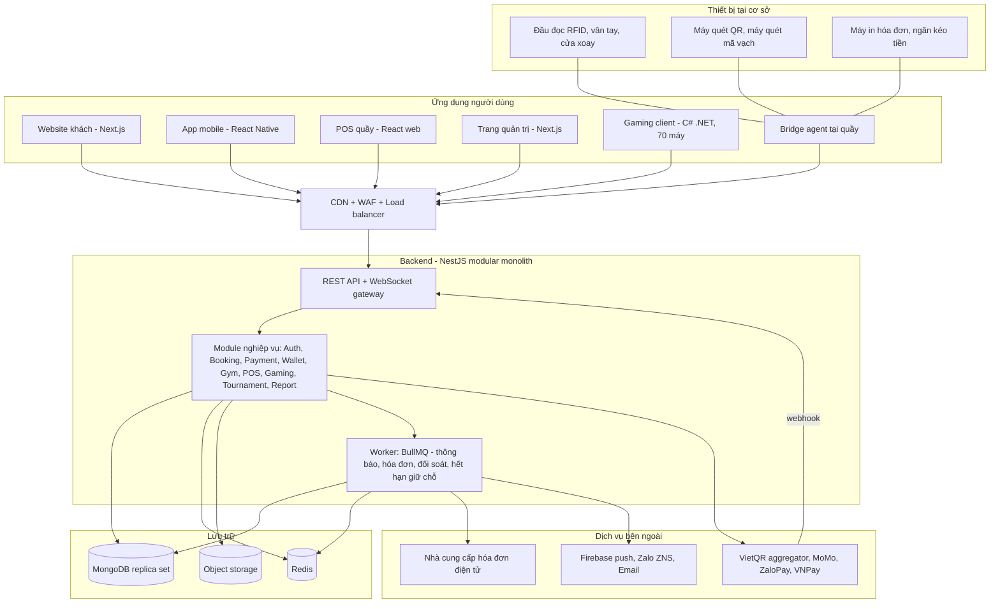

### 3.2 Công nghệ sử dụng

| Lớp | Công nghệ | Lý do chọn |
|---|---|---|
| Backend | NestJS (Node.js, TypeScript) | Cấu trúc module rõ ràng, dùng chung ngôn ngữ với web và mobile |
| Cơ sở dữ liệu | MongoDB 7+ chạy **replica set** (MongoDB Atlas hoặc tự quản lý) | Bắt buộc có replica set để dùng transaction nhiều tài liệu |
| Cache, khóa, hàng đợi | Redis 7 (bật persistence AOF) | Khóa giữ chỗ, bộ đếm gym, hàng đợi BullMQ, giới hạn tốc độ |
| Web khách, quản trị | Next.js (React, TypeScript) | Tối ưu tải trang, dùng chung thư viện giao diện |
| Mobile | React Native (TypeScript) | Một mã cho iOS và Android, dùng chung kiểu dữ liệu với web |
| POS quầy | React web (PWA, chạy toàn màn hình) | Chạy trên máy tại quầy, dễ cập nhật |
| Gaming client | C# .NET 8 (WPF) | Cần can thiệp sâu vào Windows để khóa máy |
| Bridge agent | .NET Windows service hoặc Electron | Giao tiếp thiết bị qua SDK và cổng serial/USB |
| Thời gian thực | WebSocket (Socket.IO hoặc ws) | Lịch trống, bộ đếm gym, lệnh điều khiển máy |
| Hàng đợi | BullMQ trên Redis | Gửi thông báo, xuất hóa đơn có thử lại |
| Thanh toán | VietQR qua đơn vị trung gian (payOS, SePay, Casso hoặc tương đương), MoMo, ZaloPay, VNPay | Tự động đối soát, có webhook |
| Hóa đơn điện tử | MISA meInvoice, Viettel S-Invoice hoặc VNPT (chọn một, thiết kế dạng adapter) | Chọn theo báo giá và API |
| Thông báo | Firebase Cloud Messaging, Zalo ZNS, email (SES/SendGrid) | Theo kênh đã chốt |
| Hạ tầng | Docker, AWS hoặc GCP (Singapore), IaC bằng Terraform | Lặp lại được, dễ khôi phục |
| CI/CD | GitHub Actions hoặc GitLab CI | Kiểm thử và triển khai tự động |
| Giám sát | Sentry, Prometheus + Grafana (hoặc dịch vụ giám sát của nhà cung cấp cloud), Loki/CloudWatch cho log | Phát hiện lỗi sớm |
| Kiểm thử | Jest, Supertest, Playwright, k6, xUnit/NUnit (.NET), Maestro hoặc Detox (React Native) | Phủ đủ các tầng |

### 3.3 Nguyên tắc thiết kế

1. **Modular monolith**: một ứng dụng NestJS chia module có ranh giới rõ (mỗi module sở hữu collection riêng, module khác chỉ gọi qua service công khai). Một cơ sở với quy mô này không cần microservices; chia nhỏ sớm chỉ làm tăng chi phí vận hành.
2. **Tiền là số nguyên VND** (`Int64`), không dùng số thực. Mọi thay đổi số dư đều đi qua sổ cái bất biến.
3. **Idempotency xuyên suốt**: mọi API tạo/đổi trạng thái liên quan tiền hoặc chỗ đặt đều nhận `Idempotency-Key`; webhook thanh toán được khử trùng bằng mã giao dịch của cổng.
4. **Nguồn sự thật là MongoDB**. Redis chỉ để tăng tốc và giảm tranh chấp; mất Redis không được làm sai dữ liệu tiền hoặc đặt chỗ.
5. **Thời gian**: lưu UTC, hiển thị và tính khung giờ theo `Asia/Ho_Chi_Minh`. Máy chủ là nguồn thời gian duy nhất (gaming client không tin đồng hồ của máy).
6. **Cấu hình trong dữ liệu**: giá, chính sách hủy, hạn giữ chỗ, danh mục dịch vụ được dùng ví, sức chứa gym... nằm trong collection `settings` và `price_rules`, quản lý sửa được, có lịch sử thay đổi.
7. **Outbox pattern**: sự kiện nghiệp vụ (đã thanh toán, đặt xong, hết hạn thẻ) ghi vào `outbox` cùng transaction, worker đọc ra để gửi thông báo và hóa đơn. Không mất sự kiện khi hệ thống lỗi giữa chừng.
8. **API thiết kế trước (OpenAPI)**, sinh kiểu TypeScript dùng chung cho web, mobile, POS.
9. **Nhật ký thao tác (audit)** cho mọi thay đổi nhạy cảm, chỉ ghi thêm.

### 3.4 Các module backend

| Module | Trách nhiệm |
|---|---|
| `auth` | Đăng ký, đăng nhập, OTP, phiên, thiết bị tin cậy, RBAC |
| `facility` | Tài nguyên (sân, phòng), sân ghép, giờ mở cửa, khóa sân, bảng giá, cấu hình |
| `booking` | Công cụ đặt sân 3 lớp, hủy, đổi lịch, check-in, đặt cố định |
| `payment` | Tạo thanh toán, webhook, đối soát, hoàn tiền |
| `wallet` | Ví nội bộ, sổ cái, nạp, rút, điều chỉnh |
| `invoice` | Hóa đơn điện tử |
| `notification` | Mẫu, kênh, hàng đợi, ưu tiên |
| `membership` | Gói và thẻ gym, gia hạn, nâng cấp, kiểm soát vào ra, bộ đếm sức chứa |
| `staff` | Hồ sơ nhân sự, PT, ca làm việc, lớp học |
| `pos` | Sản phẩm, kho, đơn bán, ca thu ngân |
| `rental` | Dụng cụ cho thuê |
| `gaming` | Máy, nhóm máy, phiên chơi, giá, điều khiển từ xa, đồng bộ offline |
| `promotion` | Voucher, gói combo |
| `tournament` | Giải đấu, đội, lịch, kết quả |
| `report` | Báo cáo, tổng hợp số liệu |
| `audit` | Nhật ký thao tác |
| `realtime` | Cổng WebSocket |

### 3.5 Mô hình sân và sân ghép

Quy tắc cốt lõi: **mọi sân quy về "đơn vị cơ sở" nhỏ nhất**. Khóa chỗ luôn thực hiện trên các đơn vị cơ sở, kể cả khi khách đặt sân ghép.

| Tài nguyên | Loại | Gồm các đơn vị cơ sở |
|---|---|---|
| F1 đến F6 | Sân 5, đơn vị cơ sở | chính nó |
| F7, F8 | Sân 5 độc lập, đơn vị cơ sở | chính nó |
| S7-A | Sân 7 (ghép) | F1, F2 |
| S7-B | Sân 7 (ghép) | F3, F4 |
| S7-C | Sân 7 (ghép) | F5, F6 |
| S11 | Sân 11 (ghép) | F1, F2, F3, F4, F5, F6 |
| T1, T2 | Tennis | chính nó |
| B1, B2 | Cầu lông | chính nó |
| BB1, BB2 | Bóng rổ | chính nó |
| R01 đến R10 | Phòng gaming riêng | chính nó |

Hệ quả:
- Đặt S11 sẽ khóa đồng thời 6 đơn vị F1..F6. Khi đó S7-A, S7-B, S7-C và F1..F6 đều tự không còn đặt được trong khung giờ đó.
- Đặt F1 sẽ làm S7-A và S11 không còn trống.
- Việc "không còn trống" không cần tính phức tạp: chỉ cần kiểm tra các đơn vị cơ sở tương ứng đã có chỗ hay chưa.
- Giá của sân ghép là giá riêng theo loại sân (sân 5, sân 7, sân 11), không phải cộng giá các sân con.

### 3.6 Cơ chế chống trùng lặp 3 lớp

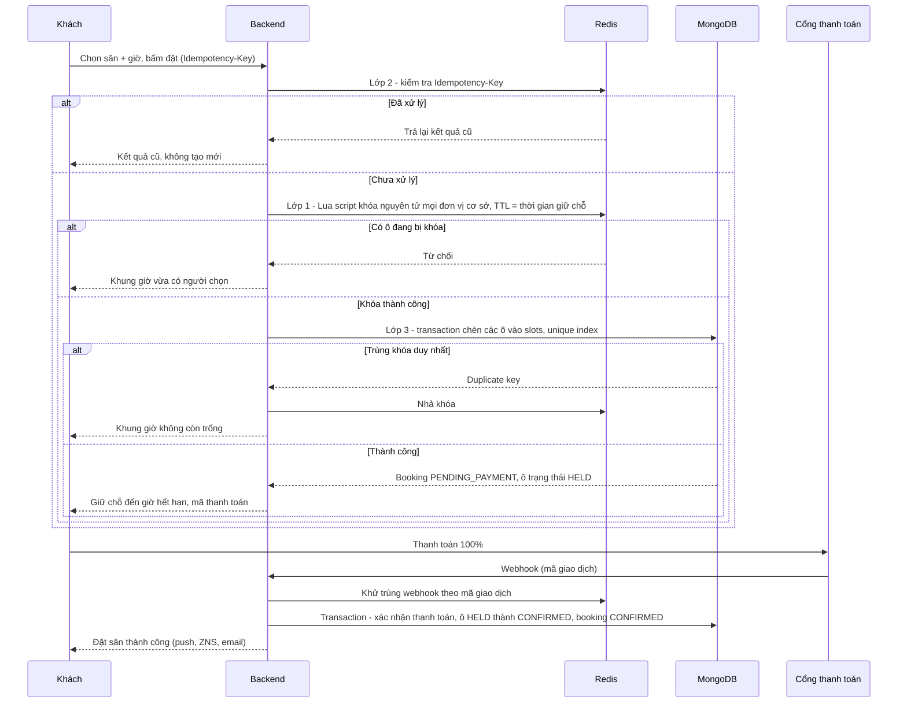

**Chi tiết từng lớp**

| Lớp | Công cụ | Chặn lỗi nào | Khi lớp này hỏng |
|---|---|---|---|
| 1. Khóa giữ chỗ | Redis, key `lock:slot:{đơn vị cơ sở}:{ngày}:{chỉ số ô}`, Lua script khóa tất cả hoặc không khóa gì, TTL bằng thời gian giữ chỗ | Hai người chọn cùng lúc; giảm tải cho DB | Lớp 3 vẫn chặn đúng, chỉ chậm hơn |
| 2. Khóa định danh yêu cầu | Redis, key `idem:{userId}:{key}` lưu kết quả 24 giờ; bảng `idempotency_keys` trong MongoDB cho thanh toán | Bấm đúp, app tự gửi lại, webhook gửi lặp | Lớp 3 và ràng buộc unique mã giao dịch chặn |
| 3. Ràng buộc dữ liệu | MongoDB: unique index `(unitId, date, slotIndex)` trên `slots`, unique `(provider, providerTxnId)` trên `payments`; ghi trong transaction | Mọi trường hợp lọt qua hai lớp trên | Đây là chốt chặn cuối, không có lớp nào sau nó |

**Hai tình huống đặc biệt phải xử lý**
1. **Ô giữ chỗ đã hết hạn nhưng chưa được dọn**: khi chèn bị trùng khóa, hệ thống kiểm tra bản ghi cũ; nếu `status = HELD` và `holdExpiresAt < now`, dùng `findOneAndUpdate` có điều kiện để chiếm ô một cách nguyên tử. Worker dọn ô hết hạn chạy mỗi 30 giây.
2. **Khách thanh toán sau khi giữ chỗ đã hết hạn** (chuyển khoản chậm): webhook đến, hệ thống kiểm tra ô. Nếu ô vẫn còn trống thì tự xác nhận booking; nếu ô đã bị người khác lấy thì **tự hoàn tiền vào ví** kèm thông báo và đề xuất khung giờ thay thế.

### 3.7 Chiến lược chịu mất mạng

**Gaming client (bắt buộc)**

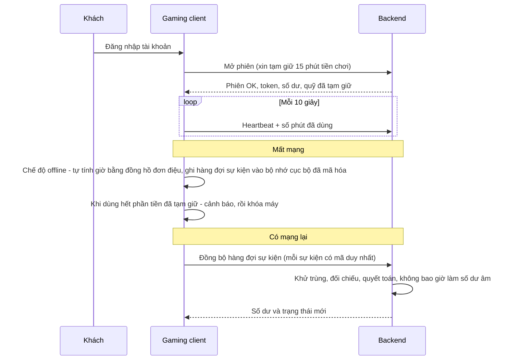

Nguyên tắc:
- **Tạm giữ theo từng đợt** (ví dụ 15 phút) giúp khách không thể tiêu quá số dư và vẫn chơi được khi mất mạng ngắn.
- Mất mạng lâu hơn phần tạm giữ: máy hiển thị cảnh báo rồi khóa; khi có mạng lại, đồng bộ rồi mở lại.
- Máy mất điện hoặc tắt đột ngột: phiên tự kết thúc theo **mốc heartbeat cuối** (sau 3 phút không có tín hiệu), khách không bị tính thừa.
- Khuyến nghị lắp **đường truyền Internet dự phòng** (hai nhà mạng) cho tổ hợp; có thể bổ sung gateway nội bộ ở giai đoạn sau nếu cần.

**Bridge agent và kiểm soát vào gym**
- Agent giữ **bản sao mã hóa** danh sách thành viên còn hạn (đồng bộ mỗi phút) để cửa vẫn mở/đóng đúng khi mất mạng.
- Mọi lượt vào/ra được ghi hàng đợi cục bộ và đồng bộ lại khi có mạng. Trong lúc offline, bộ đếm 100 người do agent tạm tính, sau đó đối chiếu.

### 3.8 Kiến trúc bảo mật

| Hạng mục | Thiết kế |
|---|---|
| Xác thực | Mật khẩu băm Argon2id; JWT access token 15 phút; refresh token 30 ngày xoay vòng, lưu dạng băm, thu hồi được theo thiết bị |
| OTP | 6 chữ số, hiệu lực 5 phút, tối đa 5 lần nhập sai, gửi lại cách nhau 60 giây, tối đa 5 OTP/giờ/số điện thoại |
| Phân quyền | RBAC theo khóa quyền chi tiết (xem Phụ lục A), kiểm tra ở backend, không tin giao diện |
| Truyền tải | TLS 1.2+ mọi nơi; gaming client và bridge agent dùng token ký riêng cho từng thiết bị, thu hồi được |
| Lưu trữ | Mã hóa đĩa của MongoDB/Redis/storage; **mã hóa cấp trường** (AES-256-GCM, khóa trong KMS/secrets manager) cho mẫu vân tay và dữ liệu cá nhân nhạy cảm |
| Webhook | Xác minh chữ ký của từng cổng, danh sách IP cho phép nếu cổng hỗ trợ, khử trùng theo mã giao dịch |
| Chống lạm dụng | Giới hạn tốc độ theo IP và tài khoản, chống dò mật khẩu (khóa 15 phút sau 5 lần sai), CAPTCHA ở đăng ký |
| Nhật ký thao tác | Collection `audit_logs` chỉ ghi thêm, có băm chuỗi (mỗi bản ghi chứa băm bản ghi trước) để phát hiện sửa đổi |
| Sao lưu | Snapshot hàng ngày + sao lưu liên tục điểm-thời-gian (PITR); thử khôi phục định kỳ hàng quý |
| Dữ liệu cá nhân | Thu thập tối thiểu, có màn hình đồng ý rõ ràng, quyền xem/sửa/xóa (ẩn danh hóa) theo yêu cầu, phân quyền xem dữ liệu cá nhân theo vai trò |
| Kiểm thử bảo mật | Quét OWASP ZAP trong CI, kiểm thử xâm nhập (pentest) bởi bên thứ ba trước khi go-live |

### 3.9 Yêu cầu phi chức năng

| Hạng mục | Mục tiêu |
|---|---|
| Tải thiết kế | 500 người dùng đồng thời trên web/app, 70 máy gaming, 100 người trong gym, 20 thiết bị POS/quầy; chịu đột biến gấp 3 lần vào giờ cao điểm |
| Độ trễ API | p95 dưới 400 ms cho thao tác thường; dưới 800 ms cho đặt sân |
| Cập nhật lịch trống | Hiển thị thay đổi cho người đang xem trong dưới 2 giây |
| Độ sẵn sàng | 99,5% mỗi tháng (không tính bảo trì có báo trước); khu gaming vẫn chạy khi mất mạng đến mức phần tạm giữ cho phép |
| Mục tiêu khôi phục | RPO tối đa 15 phút (nhờ PITR), RTO tối đa 4 giờ |
| Khả năng mở rộng | Backend chạy tối thiểu 2 bản sao sau load balancer; chạy được nhiều bản sao mà không lỗi nhờ trạng thái nằm ở Redis/MongoDB |
| Khả năng quan sát | Log có cấu trúc, mã truy vết theo yêu cầu, cảnh báo qua Zalo/email/Slack cho sự cố thanh toán, hàng đợi tắc, lỗi đồng bộ |
| Khả năng bảo trì | Phủ kiểm thử tự động tối thiểu 70% cho module tiền và đặt chỗ; tài liệu API sinh tự động |
| Tương thích | Trình duyệt hiện đại (Chrome, Safari, Edge bản mới), iOS 15+, Android 8+, Windows 10/11 cho gaming client và bridge agent |

### 3.10 Môi trường triển khai

| Môi trường | Mục đích | Ghi chú |
|---|---|---|
| Dev | Phát triển hằng ngày | Docker Compose cục bộ (Mongo replica set một nút, Redis) |
| Staging | Kiểm thử tích hợp, UAT | Giống production về cấu trúc, dùng sandbox của cổng thanh toán, hóa đơn, ZNS |
| Production | Vận hành thật | MongoDB replica set 3 nút, backend tối thiểu 2 bản sao, Redis có persistence, WAF, sao lưu, giám sát |

---

## 4. Đặc tả chi tiết chức năng

**Chú giải ưu tiên** (dùng khi cần cắt phạm vi nếu chậm tiến độ): **M** = Must (bắt buộc cho go-live), **S** = Should (nên có), **C** = Could (có thể lùi sang sau go-live).

### M01 Nền tảng kỹ thuật (không có giao diện)

Gồm: cấu trúc kho mã, quy ước mã nguồn, CI/CD, môi trường, khung NestJS (cấu hình, log, xử lý lỗi, xác thực dữ liệu), kết nối MongoDB/Redis, hàng đợi, cơ chế idempotency, outbox, bộ sinh kiểu từ OpenAPI, thư viện giao diện dùng chung. Tiêu chí hoàn thành: một yêu cầu đi suốt từ giao diện đến DB trên môi trường staging với triển khai tự động.

### M02 Định danh, xác thực, phân quyền

**Tác nhân**: khách, lễ tân, PT, quản lý, chủ, quản trị kỹ thuật.

| Mã | Chức năng | Ưu tiên |
|---|---|---|
| F02.1 | Khách đăng ký bằng số điện thoại (bắt buộc, duy nhất) + họ tên; email tùy chọn; xác minh số điện thoại bằng OTP | M |
| F02.2 | Đăng nhập số điện thoại + mật khẩu; OTP khi thiết bị mới hoặc sau 30 ngày; quên mật khẩu bằng OTP | M |
| F02.3 | Tài khoản nhân viên do quản lý tạo; luôn yêu cầu OTP mỗi phiên đăng nhập | M |
| F02.4 | Lễ tân tạo nhanh tài khoản cho khách vãng lai (nhập số điện thoại, hệ thống gửi liên kết kích hoạt, đặt mật khẩu) | M |
| F02.5 | RBAC: vai trò `OWNER`, `MANAGER`, `CASHIER`, `PT`, `CUSTOMER`, `SYSTEM_ADMIN`; quyền chi tiết theo khóa; quản lý gán và thu hồi vai trò | M |
| F02.6 | Quản lý thiết bị tin cậy, đăng xuất từ xa, khóa tài khoản | M |
| F02.7 | Hồ sơ khách: sửa thông tin, ảnh đại diện, đổi mật khẩu, thông tin xuất hóa đơn (tên, MST, địa chỉ, email), ngôn ngữ thông báo | M |
| F02.8 | Quản lý sự đồng ý: dữ liệu cá nhân, sinh trắc học, nhận tin khuyến mãi; lưu thời điểm và phiên bản điều khoản | M |
| F02.9 | Yêu cầu xóa tài khoản: ẩn danh hóa dữ liệu cá nhân, giữ lại dữ liệu tài chính theo quy định | S |
| F02.10 | Nhật ký thao tác (xem mục audit trong Phụ lục A) | M |

**Quy tắc nghiệp vụ**
1. Số điện thoại duy nhất toàn hệ thống, chuẩn hóa về dạng quốc tế trước khi lưu.
2. Mật khẩu tối thiểu 8 ký tự, không cho phép mật khẩu quá phổ biến.
3. Khóa tài khoản 15 phút sau 5 lần đăng nhập sai liên tiếp; cảnh báo cho chủ tài khoản qua kênh thông báo.
4. Nhân viên chỉ thấy dữ liệu theo quyền của vai trò (ví dụ thu ngân không xem được doanh thu tổng, PT chỉ thấy lịch và học viên của mình).
5. Tài khoản nhân viên không thể tự nâng quyền; chỉ chủ hoặc quản lý (có quyền) mới đổi vai trò, và thao tác này luôn ghi nhật ký.
6. Mẫu vân tay chỉ lưu khi có sự đồng ý rõ ràng; rút lại đồng ý thì xóa mẫu.

**Ngoại lệ**: gửi OTP thất bại (ZNS lỗi) thì dùng email dự phòng; khách đổi số điện thoại phải xác minh OTP ở số cũ và số mới.

**Nghiệm thu**: đăng ký, đăng nhập, quên mật khẩu chạy trên web/app; thu ngân gọi API doanh thu bị từ chối (403); mọi thay đổi vai trò xuất hiện trong nhật ký.

### M03 Cơ sở vật chất, bảng giá, cấu hình

| Mã | Chức năng | Ưu tiên |
|---|---|---|
| F03.1 | Quản lý tài nguyên: sân, phòng gaming, loại tài nguyên, đơn vị cơ sở, sân ghép (theo mục 3.5), trạng thái `ACTIVE`/`MAINTENANCE` | M |
| F03.2 | Giờ mở cửa theo thứ trong tuần, ngoại lệ theo ngày (đóng cửa, mở muộn) | M |
| F03.3 | Khung giờ cao điểm/thấp điểm theo loại sân (dải giờ trong ngày) | M |
| F03.4 | Bảng giá thuê sân theo (loại sân × khung giờ), có ngày hiệu lực; thay đổi tạo phiên bản mới, không sửa giá của lượt đặt cũ | M |
| F03.5 | Bảng giá phòng gaming theo giờ, giá máy sảnh theo nhóm máy × khung giờ (dùng chung cơ chế với F03.3, F03.4) | M |
| F03.6 | Khóa sân (bảo trì, sự kiện, giải đấu): phạm vi tài nguyên + thời gian + lý do; xem danh sách lượt đặt bị ảnh hưởng và xử lý từng lượt (đổi lịch hoặc hoàn tiền) | M |
| F03.7 | Cấu hình chính sách: mốc hủy (mặc định 24 giờ), thời gian giữ chỗ (mặc định 10 phút), thời lượng tối thiểu, số ngày đặt trước tối đa, số lượt giữ chỗ đồng thời mỗi khách, danh mục dịch vụ được dùng ví, sức chứa gym, tự check-out gym, hạn check-in/no-show | M |
| F03.8 | Lịch sử thay đổi cấu hình (ai, lúc nào, giá trị cũ/mới) | M |

**Quy tắc**: không xóa tài nguyên đã có lượt đặt (chỉ ngừng hoạt động); khóa sân không được làm hỏng dữ liệu lượt đặt cũ; mọi thay đổi giá có hiệu lực từ thời điểm chọn trở đi.

### M04 Đặt sân

**Tác nhân**: khách (web/app), lễ tân (POS), quản lý.

| Mã | Chức năng | Ưu tiên |
|---|---|---|
| F04.1 | Xem lịch trống theo ngày, loại sân, khung giờ (dạng lưới), cập nhật thời gian thực | M |
| F04.2 | Chọn sân và khung giờ liên tục, xem giá (đã áp giá cao/thấp điểm, voucher, gói), giữ chỗ, thanh toán 100%, xác nhận | M |
| F04.3 | Đặt sân ghép (sân 7, sân 11): tự khóa các sân con; hiển thị rõ sân 7/11 nào còn trống | M |
| F04.4 | Lễ tân đặt hộ khách tại quầy hoặc qua điện thoại; thu tiền mặt, QR hoặc trừ ví | M |
| F04.5 | Hủy lượt đặt: tính hoàn theo mốc hủy, hoàn vào ví (hoặc theo yêu cầu theo A04) | M |
| F04.6 | Đổi lịch sang khung giờ còn trống, tính chênh lệch giá | M |
| F04.7 | Check-in: QR trong app (QR động có chữ ký) hoặc lễ tân tìm theo số điện thoại/mã đặt; mở cửa sổ từ trước giờ 30 phút đến sau giờ 15 phút | M |
| F04.8 | Tự động đánh dấu **không đến** (no-show) sau 15 phút kể từ giờ bắt đầu nếu chưa check-in; không hoàn tiền | M |
| F04.9 | Thêm giờ tại chỗ: nếu ô kế tiếp còn trống, lễ tân kéo dài và thu thêm tiền | S |
| F04.10 | Lịch sử lượt đặt của khách, chi tiết, hóa đơn, mã QR | M |
| F04.11 | Quản lý xem toàn cảnh lịch (theo sân/theo ngày), thao tác hộ (hủy, đổi lịch, ghi chú) có ghi nhật ký | M |
| F04.12 | Nhắc lịch trước giờ chơi (mặc định 2 giờ) | M |

**Quy tắc nghiệp vụ**
1. Thời lượng là bội số của 30 phút, tối thiểu 60 phút (cấu hình theo A01).
2. Giá tính tại thời điểm đặt và **được lưu lại** trong lượt đặt (snapshot). Nếu một lượt đặt kéo dài qua hai khung giá (ví dụ 16:30 đến 17:30 qua mốc cao điểm 17:00) thì tính theo từng ô.
3. Thời gian giữ chỗ mặc định 10 phút; hết hạn tự nhả chỗ, booking chuyển `EXPIRED`.
4. Mỗi khách giữ tối đa 2 lượt chờ thanh toán cùng lúc (chống chiếm chỗ).
5. **Hoàn tiền**: nếu `bây giờ ≤ giờ bắt đầu − 24 giờ` thì hoàn 100% số tiền đã trả; sau mốc đó hoàn 0 đồng (theo A02). Voucher đã dùng được hoàn lại nếu còn hạn (A20).
6. **Đổi lịch**: chỉ đổi được khi còn từ 2 giờ trở lên trước giờ bắt đầu, cùng loại sân, tối đa 2 lần/lượt đặt; phần giá chênh lệch: khung mới đắt hơn thì thu thêm, rẻ hơn thì hoàn vào ví.
7. Thao tác đặt, hủy, đổi lịch chạy trong transaction MongoDB; booking và các ô `slots` luôn nhất quán.
8. Thanh toán bằng ví nội bộ được phép cho đặt sân (theo cấu hình danh mục ví).
9. Khi quản lý khóa sân trùng lượt đã đặt, hệ thống **không tự hủy**; liệt kê danh sách và yêu cầu xử lý từng lượt (đổi lịch miễn phí hoặc hoàn 100%) kèm thông báo cho khách.

**Máy trạng thái lượt đặt**

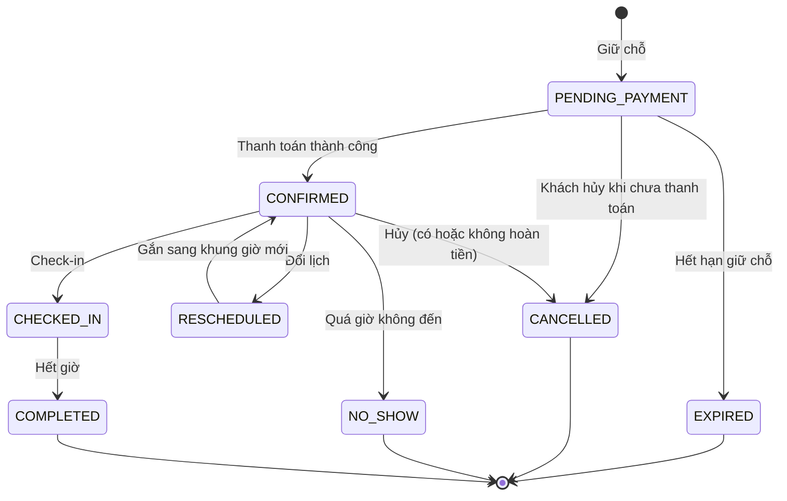

**Ngoại lệ phải xử lý**: thanh toán đến muộn sau khi giữ chỗ hết hạn (xem 3.6); webhook gửi lặp; số tiền chuyển khoản khác số tiền cần trả (đánh dấu `MISMATCH`, chờ quản lý xử lý); ô vừa bị khóa bảo trì; hai lễ tân thao tác cùng lượt đặt (khóa lạc quan bằng trường `version`).

**Nghiệm thu**: bắn đồng thời 200 yêu cầu đặt cùng một ô cho kết quả **đúng 1** thành công; đặt sân 11 làm 6 sân 5 và 3 sân 7 cùng khung giờ không đặt được; hủy trước 24 giờ hoàn đúng tiền vào ví; hủy sau mốc không hoàn.

### M05 Đặt sân cố định (đội, nhóm)

| Mã | Chức năng | Ưu tiên |
|---|---|---|
| F05.1 | Tạo lịch cố định: sân, các thứ trong tuần, giờ, thời lượng, từ ngày đến ngày (tối đa 12 tuần mỗi lần tạo) | S |
| F05.2 | Hệ thống kiểm tra xung đột **toàn bộ** các buổi trước khi tạo; có xung đột thì báo danh sách ngày trùng để chọn bỏ qua hoặc đổi sân/giờ | S |
| F05.3 | Thanh toán theo kỳ (tháng hoặc tuần) trước khi buổi đầu của kỳ diễn ra | S |
| F05.4 | Nghỉ một buổi: báo trước ít nhất 24 giờ thì dời sang khung khác còn trống hoặc ghi có vào ví | S |
| F05.5 | Sân đóng cửa/bảo trì đúng buổi cố định: dời lịch hoặc hoàn tiền buổi đó | S |
| F05.6 | Gia hạn, kết thúc, tạm dừng lịch cố định; nhắc gia hạn trước 7 ngày | S |

**Quy tắc**: mỗi buổi là một booking độc lập liên kết với lịch cố định (`recurringRuleId`), nên mọi quy tắc của M04 (hoàn tiền, check-in, no-show) áp dụng cho từng buổi; giá của các buổi trong kỳ đã trả được chốt tại thời điểm thanh toán.

### M06 Thanh toán

| Mã | Chức năng | Ưu tiên |
|---|---|---|
| F06.1 | Tiền mặt tại POS: thu ngân nhập số tiền khách đưa, hệ thống tính tiền thừa, gắn với ca | M |
| F06.2 | VietQR: tạo mã QR theo từng đơn với nội dung chuyển khoản duy nhất; tự nhận diện giao dịch qua webhook của đơn vị trung gian | M |
| F06.3 | Ví điện tử MoMo, ZaloPay, VNPay: chuyển hướng/deeplink sang ví, nhận kết quả qua IPN, đối chiếu khi khách quay lại | M |
| F06.4 | Trả bằng ví nội bộ (chỉ cho các dịch vụ được phép) | M |
| F06.5 | Thanh toán hỗn hợp tại POS (ví dụ một phần ví, một phần tiền mặt) | S |
| F06.6 | Hoàn tiền: vào ví (tức thì) hoặc về nguồn tiền gốc (tùy cổng hỗ trợ API hoặc xử lý thủ công có biên bản) | M |
| F06.7 | Đối soát hằng ngày: so khớp giao dịch hệ thống với dữ liệu của cổng; danh sách giao dịch không khớp để quản lý xử lý | M |
| F06.8 | Màn hình tra cứu giao dịch, trạng thái, lịch sử webhook | M |

**Quy tắc**
1. Mỗi giao dịch có `idempotency` theo `(provider, providerTxnId)`; xử lý lặp chỉ có tác dụng một lần.
2. Số tiền nhận phải **khớp chính xác** số tiền cần trả. Thừa hoặc thiếu đều đưa vào trạng thái `MISMATCH`, không tự xác nhận.
3. Mọi webhook đều được xác minh chữ ký, lưu bản gốc vào `payment_events` trước khi xử lý.
4. Thanh toán QR có hạn dùng (bằng thời gian giữ chỗ); nhận tiền sau hạn thì áp dụng luồng "thanh toán muộn" của mục 3.6.
5. Một đơn có thể có nhiều thanh toán; đơn chỉ `PAID` khi tổng thanh toán thành công bằng tổng tiền đơn.
6. Chỉ danh mục dịch vụ trong cấu hình ví mới được trừ ví; nếu đơn có dòng không thuộc danh mục thì phần đó phải thanh toán bằng phương thức khác.

**Máy trạng thái thanh toán**: `CREATED → PENDING → SUCCEEDED | FAILED | EXPIRED`; từ `SUCCEEDED` có thể sang `PARTIALLY_REFUNDED` hoặc `REFUNDED`; ngoài ra có `MISMATCH` chờ xử lý.

### M07 Ví nội bộ

| Mã | Chức năng | Ưu tiên |
|---|---|---|
| F07.1 | Mỗi khách có một ví (VND). Xem số dư, lịch sử giao dịch | M |
| F07.2 | Nạp ví qua VietQR/ví điện tử, hoặc tiền mặt tại quầy (thu ngân ghi nhận) | M |
| F07.3 | Trừ ví khi thanh toán dịch vụ được phép | M |
| F07.4 | Hoàn tiền vào ví (hủy sân, hủy lớp, thanh toán muộn thất bại...) | M |
| F07.5 | Điều chỉnh thủ công số dư (quản lý, bắt buộc có lý do, có nhật ký) | M |
| F07.6 | Yêu cầu rút tiền: khách gửi yêu cầu, quản lý duyệt, chi trả, đóng yêu cầu; có OTP | S |
| F07.7 | Thông báo mỗi khi số dư thay đổi; cảnh báo số dư thấp trong khu gaming | S |
| F07.8 | Đối soát số dư hằng ngày: số dư lưu bằng tổng sổ cái; chênh lệch bật cảnh báo | M |

**Quy tắc**
1. Số dư **không bao giờ âm**; mọi lệnh trừ là cập nhật có điều kiện `balance ≥ số tiền` trong cùng transaction với dòng sổ cái.
2. Sổ cái `wallet_ledger` **chỉ ghi thêm**, không sửa, không xóa. Sai sót được sửa bằng bút toán điều chỉnh mới.
3. Nạp và rút luôn yêu cầu OTP (A12). Hạn mức mặc định: nạp tối thiểu 20.000 đ; nạp tại quầy tối đa 5.000.000 đ mỗi lần (vượt cần quản lý duyệt); số dư tối đa 20.000.000 đ (cấu hình).
4. Ví không dùng cho thẻ gym, sản phẩm thể thao, lớp học/PT, lệ phí giải đấu (theo yêu cầu đã chốt).
5. Tạm giữ (hold) tiền ví cho phiên gaming theo từng đợt; tiền đang tạm giữ không dùng được cho giao dịch khác (xem M14).

### M08 Hóa đơn điện tử

| Mã | Chức năng | Ưu tiên |
|---|---|---|
| F08.1 | Tự động tạo và phát hành hóa đơn điện tử cho mọi giao dịch đã thanh toán (theo A06 về nạp ví) | M |
| F08.2 | Thông tin người mua: mặc định "khách lẻ"; nếu khách đã lưu thông tin công ty thì xuất đúng thông tin đó | M |
| F08.3 | Kiến trúc adapter cho nhà cung cấp hóa đơn (MISA, Viettel, VNPT), cấu hình bằng khóa API | M |
| F08.4 | Hàng đợi có thử lại; trạng thái `PENDING → ISSUED`; lỗi quá số lần thử bật cảnh báo | M |
| F08.5 | Gửi hóa đơn qua email, xem và tải PDF trong app/web; in tại POS | M |
| F08.6 | Hủy, điều chỉnh, thay thế hóa đơn khi hoàn tiền hoặc sai sót (theo quy trình của nhà cung cấp) | S |
| F08.7 | Báo cáo đối soát hóa đơn và đơn hàng (đơn nào chưa có hóa đơn) | M |

**Lưu ý**: số lượng hóa đơn rất lớn (mỗi đơn canteen đều có hóa đơn), cần chọn gói hóa đơn theo số lượng và kiểm tra giới hạn gọi API của nhà cung cấp; cần kế toán xác nhận quy tắc xuất hóa đơn cho giờ chơi gaming (xuất khi kết thúc phiên) và cho nạp ví.

### M09 Thông báo

| Mã | Chức năng | Ưu tiên |
|---|---|---|
| F09.1 | Kênh: push (FCM/APNs), Zalo ZNS/OA, email | M |
| F09.2 | Mẫu thông báo có biến, quản lý sửa; mỗi sự kiện có mẫu theo từng kênh (xem Phụ lục B) | M |
| F09.3 | Hàng đợi có thử lại (3 lần, giãn cách tăng dần); chuỗi dự phòng kênh theo mức ưu tiên (ví dụ push thất bại thì gửi ZNS) | M |
| F09.4 | Tùy chọn kênh nhận của từng khách (không áp dụng cho thông báo giao dịch bắt buộc như OTP) | S |
| F09.5 | Trung tâm thông báo trong app (đã đọc/chưa đọc) | S |
| F09.6 | Nhật ký gửi, trạng thái giao nhận, chi phí ZNS theo ngày; hạn mức chi phí/ngày cấu hình được | M |
| F09.7 | Gửi thông báo hàng loạt (chiến dịch) tới nhóm khách, tôn trọng việc từ chối nhận tin | C |

**Lưu ý triển khai**: mẫu tin ZNS phải được Zalo phê duyệt trước khi dùng, thời gian duyệt có thể mất nhiều ngày, nên nộp mẫu sớm ở GĐ1.

### M10 Phòng gym: thẻ thành viên và kiểm soát vào ra

| Mã | Chức năng | Ưu tiên |
|---|---|---|
| F10.1 | Quản lý gói thẻ: tên, thời hạn (tháng/quý/năm), giá, quyền lợi, trạng thái bán | M |
| F10.2 | Mua thẻ tại quầy hoặc online; thanh toán tiền mặt, QR, ví điện tử (**không** ví nội bộ); có thể chọn ngày bắt đầu (tối đa 30 ngày sau), thẻ chưa đến ngày ở trạng thái `UPCOMING` | M |
| F10.3 | **Gia hạn**: cộng dồn thời gian; ưu đãi gia hạn sớm | M |
| F10.4 | **Nâng cấp** giữa chừng, bù tiền chênh lệch | M |
| F10.5 | Gán thẻ RFID vật lý cho thành viên; khóa và cấp lại khi mất thẻ (có thể thu phí cấp lại) | M |
| F10.6 | Đăng ký vân tay (tùy chọn, có đồng ý) | S |
| F10.7 | Check-in/check-out bằng RFID, vân tay, QR động trong app hoặc thủ công qua lễ tân (bắt buộc ghi lý do) | M |
| F10.8 | Bộ đếm người đang tập theo thời gian thực, giới hạn 100; hiển thị "đang tập X/100" trên app, web và màn hình quầy | M |
| F10.9 | Nhắc hết hạn trước 7 ngày và 1 ngày; thông báo khi hết hạn | M |
| F10.10 | Danh sách thành viên, tìm kiếm, lịch sử lượt tập, trạng thái thẻ, thao tác tại quầy | M |
| F10.11 | Báo cáo: thành viên đang hoạt động, sắp hết hạn, tỷ lệ gia hạn, lượt vào theo giờ | M |

**Quy tắc nghiệp vụ**
1. **Gia hạn**: nếu thẻ còn hạn thì thời gian mới bắt đầu từ `ngày hết hạn + 1` (cộng dồn); nếu đã hết hạn thì bắt đầu từ ngày mua. **Ưu đãi gia hạn sớm**: gia hạn khi còn từ N ngày trở lên (mặc định 7) thì giảm X% (cấu hình theo từng gói).
2. **Nâng cấp** (theo A10): `giá trị còn lại = giá đã trả của gói cũ × số ngày còn lại / tổng số ngày của gói cũ`; `số tiền phải trả = max(0, giá gói mới − giá trị còn lại)`; gói mới bắt đầu từ ngày nâng cấp với đủ thời hạn của gói mới; gói cũ chuyển `UPGRADED`. Không hạ cấp.
3. **Điều kiện vào**: thẻ `ACTIVE` và trong hạn; số người đang trong phòng nhỏ hơn 100; không đang ở trạng thái "đã vào chưa ra" (anti-passback, cấu hình bật/tắt).
4. **Bộ đếm 100 người**: bằng Redis (tập hợp `gym:inside` + script Lua nguyên tử kiểm tra và thêm người); nếu đầy thì từ chối vào kèm thông báo "đang đầy, vui lòng chờ"; có tác vụ đối chiếu định kỳ với bản ghi `gym_access_events`.
5. **Tự check-out** sau 4 giờ (A11) hoặc khi lễ tân thao tác; check-out lỡ làm bộ đếm sai được sửa khi đối chiếu.
6. QR động trong app đổi mỗi 30 giây, có chữ ký, dùng một lần; chụp màn hình không dùng lại được.
7. Mất thẻ RFID: khóa thẻ cũ ngay, thẻ mới gán cho cùng thành viên.
8. Mọi thao tác thủ công của lễ tân (cho vào bằng tay, sửa hạn thẻ) đều ghi nhật ký có lý do.

**Luồng check-in**

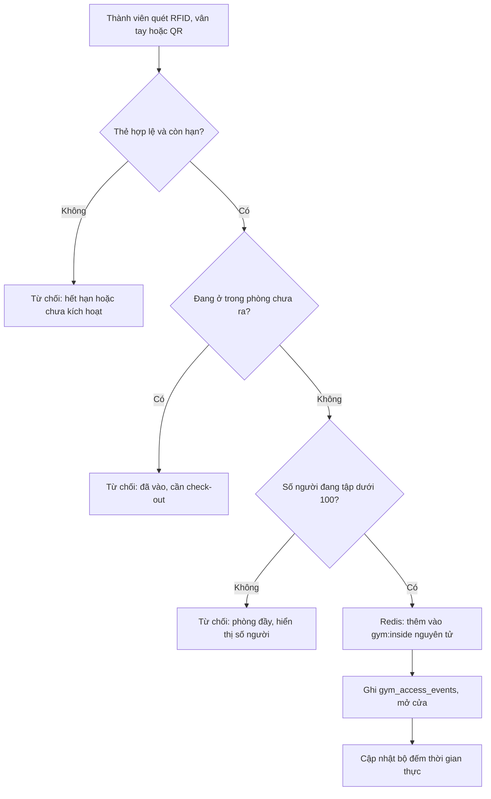

**Offline**: bridge agent giữ danh sách thẻ còn hạn đã mã hóa, tự quyết định mở cửa; sự kiện đồng bộ khi có mạng; trong lúc offline bộ đếm do agent tạm tính.

**Nghiệm thu**: 150 người quét cùng lúc khi đang có 90 người thì **đúng 10** người vào được; gia hạn khi còn hạn cộng dồn đúng; nâng cấp tính đúng số tiền theo công thức; mở cửa vẫn đúng khi ngắt mạng 10 phút.

### M11 PT, lớp học, nhân sự

| Mã | Chức năng | Ưu tiên |
|---|---|---|
| F11.1 | Hồ sơ nhân viên: thông tin, vai trò, ảnh, chứng chỉ, trạng thái làm việc | M |
| F11.2 | Hồ sơ PT: chuyên môn, giới thiệu, ảnh (hiển thị cho khách) | S |
| F11.3 | Lịch làm việc và ca (quản lý xếp ca, kéo-thả); nhân viên xem ca của mình | S |
| F11.4 | Chấm công cơ bản: vào ca, ra ca (qua POS hoặc app nhân viên) | C |
| F11.5 | Lớp học: mẫu lớp (tên, loại, PT phụ trách, sức chứa, giá mỗi buổi, lịch lặp), tự sinh các buổi | S |
| F11.6 | Khách đăng ký lớp theo buổi, thanh toán (không dùng ví nội bộ), hủy theo hạn cấu hình (mặc định 12 giờ trước), điểm danh | S |
| F11.7 | Hủy hoặc dời buổi lớp: thông báo cho học viên, hoàn tiền | S |
| F11.8 | PT 1-1: đặt buổi PT theo lịch rảnh của PT; gói buổi PT mua qua M15 (trừ buổi khi điểm danh) | S |
| F11.9 | PT xem lịch dạy, danh sách học viên, lịch sử buổi tập, ghi chú buổi tập | S |
| F11.10 | Ghi nhận thưởng cho PT thủ công; xuất bảng số buổi dạy theo tháng cho kế toán | C |

**Quy tắc**: PT không bị xếp trùng giờ; lớp không vượt sức chứa; PT chỉ xem dữ liệu học viên của chính mình; lương cố định **không** tính trong hệ thống (ngoài phạm vi), chỉ lưu thưởng và xuất dữ liệu.

### M12 POS, canteen, bán lẻ, kho, ca thu ngân

| Mã | Chức năng | Ưu tiên |
|---|---|---|
| F12.1 | Danh mục sản phẩm: nhóm (`CANTEEN` hoặc `RETAIL`), SKU, mã vạch, giá bán, giá vốn, thuế suất, đơn vị, theo dõi tồn kho, ảnh | M |
| F12.2 | Bán hàng tại POS: tìm hoặc quét mã vạch, giỏ hàng, ghi chú, chọn khách theo số điện thoại (bắt buộc nếu trả bằng ví), áp voucher, giảm giá thủ công (theo hạn mức quyền) | M |
| F12.3 | Thanh toán, in biên lai/hóa đơn 80mm, mở ngăn kéo tiền, gửi hóa đơn điện tử (M08) | M |
| F12.4 | Hủy đơn, hoàn hàng: cần mã PIN quản lý, có nhật ký | M |
| F12.5 | Mở ca (nhập tiền đầu ca) và chốt ca (nhập tiền thực đếm, hệ thống tính chênh lệch), báo cáo ca | M |
| F12.6 | Nhập hàng: phiếu nhập (tùy chọn kèm đơn đặt hàng nhà cung cấp), cập nhật tồn và giá vốn bình quân gia quyền | M |
| F12.7 | Xuất kho: bán, hủy hàng, hao hụt (có lý do) | M |
| F12.8 | Kiểm kê: lập phiếu kiểm, nhập số thực tế, tạo chênh lệch và điều chỉnh tồn có duyệt | S |
| F12.9 | Cảnh báo tồn dưới ngưỡng, báo cáo bán chạy, lãi gộp | S |
| F12.10 | Cho phép đơn ghép (canteen + giờ gaming + thuê dụng cụ) trên một hóa đơn tại quầy | S |

**Quy tắc**
1. Ví nội bộ chỉ trừ cho dòng thuộc nhóm `CANTEEN` (không cho `RETAIL`).
2. Mỗi thu ngân chỉ có một ca mở tại một thời điểm; không bán hàng khi chưa mở ca; không đăng xuất cuối ngày khi chưa chốt ca.
3. Tồn kho không âm (cấu hình cho phép bán âm tạm thời chỉ với quyền quản lý).
4. Giá bán đã gồm thuế; tách thuế khi xuất hóa đơn theo thuế suất của sản phẩm.
5. Hủy đơn đã in hóa đơn điện tử thì chạy quy trình hủy/điều chỉnh hóa đơn.

### M13 Cho thuê dụng cụ

| Mã | Chức năng | Ưu tiên |
|---|---|---|
| F13.1 | Danh mục dụng cụ (vợt tennis, vợt cầu lông, bóng, giày, áo bib...): quản lý theo số lượng hoặc theo mã tài sản từng món | S |
| F13.2 | Giá thuê theo lượt hoặc theo giờ; tiền cọc (cấu hình, mặc định không) | S |
| F13.3 | Tạo phiếu thuê tại POS, gắn với lượt đặt sân hoặc độc lập; thanh toán (được dùng ví) | S |
| F13.4 | Trả đồ: ghi tình trạng (tốt, hỏng, mất), tính phí hư hỏng/mất, hoàn cọc | S |
| F13.5 | Số lượng khả dụng theo thời gian thực, cảnh báo thiếu và quá hạn trả | S |
| F13.6 | Báo cáo tần suất thuê, doanh thu cho thuê, tài sản hỏng | S |

**Quy tắc**: không cho thuê vượt số lượng khả dụng; chốt ca báo cảnh báo nếu còn dụng cụ chưa trả của ca đó; dụng cụ hỏng/mất tự trừ khỏi số lượng khả dụng.

### M14 Khu gaming

**Tác nhân**: khách chơi, thu ngân/lễ tân, quản lý. **Thành phần**: module server `gaming` + **Gaming client** trên từng máy.

**Server**

| Mã | Chức năng | Ưu tiên |
|---|---|---|
| F14.1 | Quản lý máy: mã máy, nhóm (thường/VIP, cấu hình), vị trí trên sơ đồ, trạng thái `OFFLINE/IDLE/IN_USE/LOCKED/MAINTENANCE`, đăng ký thiết bị bằng mã dùng một lần | M |
| F14.2 | Bảng giá theo nhóm máy × khung giờ (cao/thấp điểm), bước tính phút, mức tính tối thiểu (cấu hình) | M |
| F14.3 | Phiên chơi: mở khi khách đăng nhập, tính tiền thời gian thực, kết thúc, quyết toán vào sổ cái và đơn hàng | M |
| F14.4 | Tạm giữ tiền theo đợt (mặc định 15 phút); cảnh báo còn 10, 5, 1 phút; hết tiền thì khóa máy (có thời gian ân hạn 60 giây, cấu hình) | M |
| F14.5 | Sơ đồ phòng máy thời gian thực: màu theo trạng thái, người đang chơi, thời gian đã dùng, tiền | M |
| F14.6 | Điều khiển từ xa: khóa, mở, nhắn tin, khởi động lại, tắt máy, kết thúc phiên, chuyển máy giữ nguyên phiên | M |
| F14.7 | Thu ngân mở phiên hộ, nạp tiền cho khách ngay trên màn hình quản lý máy | M |
| F14.8 | Phòng riêng (10 phòng): đặt theo ô giờ qua công cụ M04 (loại tài nguyên `GAME_ROOM`), check-in QR, mở khóa các máy trong phòng cho nhóm khách trong khung giờ đã đặt, thêm giờ nếu phòng còn trống | M |
| F14.9 | Đồng bộ offline: nhận hàng đợi sự kiện từ client, khử trùng, đối chiếu, quyết toán | M |
| F14.10 | Báo cáo gaming: giờ chơi, tỷ lệ sử dụng từng máy, doanh thu theo giờ/nhóm | S |

**Gaming client (C#/.NET trên Windows)**

| Mã | Chức năng | Ưu tiên |
|---|---|---|
| F14.11 | Màn hình khóa toàn màn hình (chế độ kiosk), tự chạy khi khởi động máy, không thoát được khi chưa có phiên | M |
| F14.12 | Đăng nhập bằng số điện thoại + mật khẩu, hoặc quét QR từ app khách | M |
| F14.13 | Thanh trạng thái hiển thị số dư, thời gian đã chơi, tiền đã tính, cảnh báo sắp hết | M |
| F14.14 | Nạp ví ngay tại máy: hiển thị VietQR của khách | S |
| F14.15 | Nhận lệnh từ server qua WebSocket (khóa, nhắn tin, tắt máy...) | M |
| F14.16 | Chế độ offline: đồng hồ đơn điệu, hàng đợi sự kiện lưu mã hóa (SQLite + DPAPI), đồng bộ khi có mạng | M |
| F14.17 | Chống can thiệp: chặn tổ hợp phím thoát, vô hiệu hóa Task Manager theo chính sách, phát hiện tiến trình bị tắt, mã nhị phân có chữ ký số | M |
| F14.18 | Tự cập nhật theo đợt (cập nhật ngoài giờ cao điểm, quay lui được khi lỗi) | M |
| F14.19 | Chế độ giải đấu esports (bật/tắt từ server, xem M16) | C |

**Quy tắc nghiệp vụ**
1. Mỗi tài khoản chỉ có **một phiên đang hoạt động**; đăng nhập máy khác sẽ bị từ chối hoặc (cấu hình) đá phiên cũ.
2. Tiền tính **theo phút, làm tròn lên**; nếu phiên đi qua mốc đổi khung giá, mỗi phút được tính theo khung giá của chính phút đó.
3. Tạm giữ tiền: ví bị trừ ngay phần tạm giữ (đợt 15 phút), đợt tiếp theo được tạm giữ trước khi hết đợt; khi kết thúc, hoàn phần dư vào ví. Cách này đảm bảo **không bao giờ tiêu quá số dư**, kể cả khi khách đồng thời mua canteen.
4. Máy mất điện/tắt đột ngột: phiên kết thúc theo mốc heartbeat cuối (sau 3 phút không có tín hiệu).
5. Đồng hồ máy khách không được tin; thời gian tham chiếu là máy chủ, offline dùng đồng hồ đơn điệu.
6. Phòng riêng: tiền tính theo giá phòng và khung giờ đã đặt (không tính theo phút từng máy); chơi lố giờ thì thu thêm theo giá phòng.

**Máy trạng thái phiên chơi**

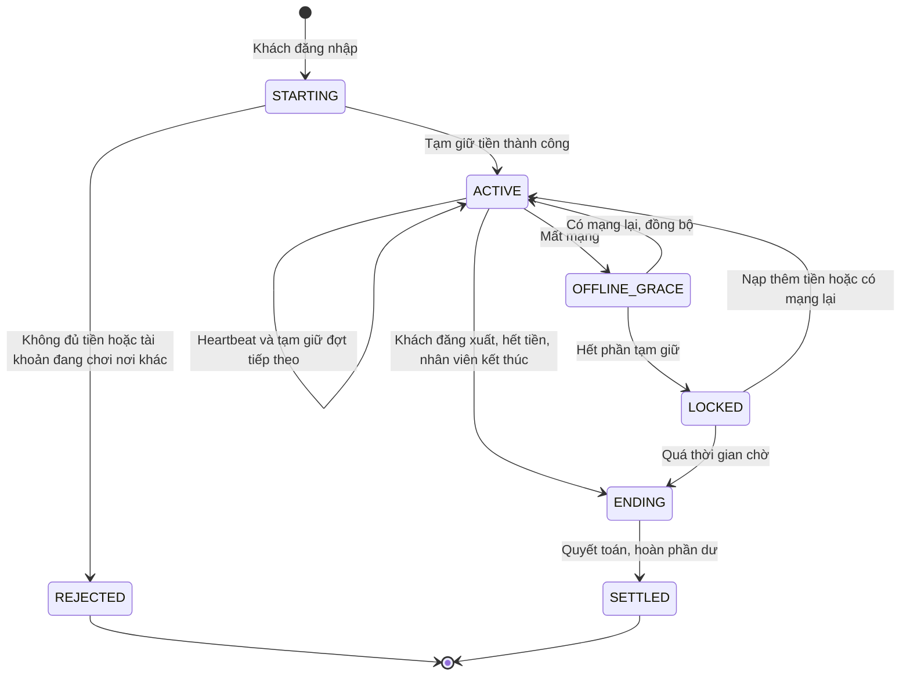

**Nghiệm thu**: rút dây mạng một máy 10 phút trong khi khách đang chơi, sau đó cắm lại thì số tiền khớp tới từng phút và không âm; khách đăng nhập 2 máy cùng lúc bị từ chối; thu ngân khóa/mở/tắt 10 máy từ xa trong dưới 3 giây.

### M15 Khuyến mãi: voucher và gói combo

| Mã | Chức năng | Ưu tiên |
|---|---|---|
| F15.1 | Tạo voucher: mã, loại (`PERCENT`/`FIXED`), giá trị, mức giảm tối đa, đơn tối thiểu, phạm vi (loại sân, dịch vụ, gói), thời hạn, giới hạn lượt dùng (tổng và mỗi khách), áp dụng cho kênh online hoặc POS | M |
| F15.2 | Áp mã khi đặt sân, mua hàng, mua thẻ, đăng ký lớp; kiểm tra điều kiện và hiển thị lý do khi không hợp lệ | M |
| F15.3 | Tạm dừng/kết thúc voucher; thống kê lượt dùng | M |
| F15.4 | Gói combo: mẫu gói (thành phần, giá, thời hạn sử dụng), ví dụ "10 giờ sân 5", "thẻ gym + 8 buổi PT" | S |
| F15.5 | Khách mua gói; số dư gói theo từng thành phần; dùng gói khi đặt sân hoặc điểm danh buổi PT (trừ vào số dư gói thay cho tiền) | S |
| F15.6 | Hết hạn gói, nhắc trước khi hết hạn; không hoàn tiền gói đã mua (trừ khi quản lý xử lý thủ công) | S |

**Quy tắc**
1. Mỗi đơn dùng tối đa **một** voucher (không cộng dồn).
2. Voucher được "tiêu" khi đơn thanh toán thành công; hủy trong hạn hoàn tiền thì hoàn voucher (A20).
3. Một gói combo **chứa thành phần ngoài danh mục ví** (ví dụ thẻ gym) thì không được thanh toán bằng ví nội bộ.
4. Đặt sân cố định thuộc M05 (không phải voucher hay gói).

### M16 Giải đấu (thể thao và esports)

| Mã | Chức năng | Ưu tiên |
|---|---|---|
| F16.1 | Tạo giải: loại (`SPORT` hoặc `ESPORT`), môn hoặc game, thể thức (loại trực tiếp, vòng tròn, chia bảng rồi loại trực tiếp), số đội tối thiểu/tối đa, số thành viên mỗi đội, lệ phí, thời gian đăng ký, thời gian thi đấu, thể lệ, giải thưởng, ảnh bìa | S |
| F16.2 | Đăng ký đội: đội trưởng tạo đội, mời thành viên bằng số điện thoại (thành viên phải có tài khoản và chấp nhận), thanh toán lệ phí (tiền mặt, QR, ví điện tử; **không** ví nội bộ) | S |
| F16.3 | Quản lý duyệt đội (hoặc tự duyệt khi đã thanh toán); đội rút lui, hoàn lệ phí trước khi đóng đăng ký | S |
| F16.4 | Bốc thăm hoặc chia bảng (ngẫu nhiên hoặc xếp hạt giống thủ công), sinh sơ đồ nhánh đấu | S |
| F16.5 | Xếp lịch trận: gợi ý gán sân/phòng/máy và khung giờ dựa trên tài nguyên trống; **khóa tài nguyên** qua cơ chế khóa sân (loại `TOURNAMENT`); cảnh báo khi trùng lượt đặt thường | S |
| F16.6 | Nhập kết quả (quản lý/thu ngân), tự động đưa đội thắng vào vòng sau, bảng xếp hạng, luật phân định thứ hạng cấu hình được; xử thua/thắng do bỏ cuộc, dời trận | S |
| F16.7 | Trang giải công khai (web/app): nhánh đấu, lịch, kết quả theo thời gian thực | S |
| F16.8 | Thông báo cho đội: lịch trận, đổi lịch, kết quả | S |
| F16.9 | Esports: gán nhóm máy cho trận, bật chế độ giải trên client, không trừ ví đội trong thời gian trận | C |
| F16.10 | Báo cáo giải: số đội, doanh thu lệ phí, chi phí giải thưởng ghi nhận | C |

**Quy tắc**: thể thức và luật phân định thứ hạng chốt **trước khi mở đăng ký** và không đổi sau khi đóng đăng ký; kết quả đã nhập chỉ sửa bởi quản lý (có nhật ký); mỗi trận chỉ gán một tài nguyên tại một thời điểm.

### M17 Báo cáo và bảng điều khiển

Số liệu được tổng hợp vào collection `daily_stats` (cập nhật gia tăng khi có sự kiện và chạy lại ban đêm để đối chiếu), giúp báo cáo nhanh mà không quét toàn bộ dữ liệu.

| Mã | Báo cáo | Chỉ số chính | Bộ lọc | Ưu tiên |
|---|---|---|---|---|
| R1 | **Doanh thu** | Tổng doanh thu gộp, giảm giá, hoàn tiền, doanh thu thuần; theo ngày/tuần/tháng/khoảng tùy chọn | Khu (sân bóng đá, tennis, cầu lông, bóng rổ, gym thẻ, lớp/PT, gaming sảnh, gaming phòng riêng, canteen, bán lẻ, cho thuê, giải đấu), phương thức thanh toán, nhân viên | M |
| R2 | **Lấp đầy** | Tỷ lệ lấp đầy = số phút được đặt / số phút mở cửa, theo sân, theo môn, bản đồ nhiệt giờ trong ngày, tỷ lệ hủy, tỷ lệ no-show, so sánh cao điểm và thấp điểm | Môn, sân, khoảng ngày | M |
| R3 | **Khách hàng** | Khách mới, khách quay lại (từ 2 lượt trong 30 ngày), khách rời bỏ (không phát sinh 60 ngày), khách giá trị cao, phân bổ theo khu, thẻ gym sắp hết hạn, tỷ lệ gia hạn | Khoảng ngày, khu | M |
| R4 | **Tồn kho và dụng cụ** | Tồn kho, hàng dưới ngưỡng, giá trị tồn, hao hụt, lãi gộp theo sản phẩm, dụng cụ đang cho thuê/quá hạn/hỏng | Nhóm, sản phẩm | M |
| R5 | **Đối soát ca thu ngân** | Ca, tiền hệ thống, tiền thực đếm, chênh lệch, đơn hủy/hoàn, theo từng thu ngân | Ngày, thu ngân | M |
| R6 | **Gaming** | Giờ chơi, tỷ lệ sử dụng từng máy, doanh thu theo giờ và nhóm máy, phòng riêng | Ngày, nhóm máy | S |
| R7 | **Gym** | Lượt vào theo giờ, đỉnh tải, số thành viên theo gói | Ngày | S |
| R8 | **Thanh toán và hóa đơn** | Giao dịch không khớp, đơn chưa có hóa đơn điện tử | Ngày | M |
| R9 | **Nhật ký thao tác** | Ai thay đổi giá, hủy đơn, hoàn tiền, điều chỉnh ví | Người dùng, loại, ngày | M |

Tính năng chung: bảng điều khiển cho chủ (doanh thu hôm nay, đang chơi, gym đang tập, cảnh báo), xuất Excel/CSV/PDF, phân quyền xem theo vai trò, gửi báo cáo ngày vào email chủ (Could).

### M22 Bridge agent và thiết bị tại quầy

| Mã | Chức năng | Ưu tiên |
|---|---|---|
| F22.1 | Đọc thẻ RFID, vân tay, mã QR/mã vạch; điều khiển cửa xoay hoặc khóa cửa; in biên lai ESC/POS; mở ngăn kéo tiền | M |
| F22.2 | Kênh WebSocket an toàn lên cloud, token riêng cho từng agent, thu hồi được | M |
| F22.3 | Bộ nhớ đệm mã hóa danh sách thành viên và hàng đợi sự kiện để chạy offline | M |
| F22.4 | Cấu hình từ xa, nhật ký, heartbeat, tự cập nhật | S |
| F22.5 | Chẩn đoán thiết bị (đầu đọc nào đang lỗi) hiển thị trên màn hình POS | S |

### Danh sách màn hình theo ứng dụng

| Ứng dụng | Màn hình chính |
|---|---|
| **Web và app khách** | Đăng ký/đăng nhập/OTP; trang chủ; lịch trống và đặt sân; thanh toán; lượt đặt của tôi (chi tiết, hủy, đổi lịch, QR); ví (số dư, nạp, lịch sử, yêu cầu rút); thẻ gym (gói, mua, gia hạn, nâng cấp, QR vào, số người đang tập); lớp học và PT; gaming (đặt phòng riêng, nạp tiền, lịch sử chơi); giải đấu (danh sách, đăng ký đội, nhánh đấu); voucher và gói của tôi; hóa đơn; thông báo; hồ sơ và quyền riêng tư |
| **POS** | Mở/chốt ca; lịch sân và đặt hộ; bán hàng canteen/bán lẻ; thuê/trả dụng cụ; tra cứu khách và tạo nhanh tài khoản; mua/gia hạn thẻ gym; check-in sân/gym; nạp ví; quản lý máy gaming; đơn hàng và hoàn/hủy; kho cơ bản |
| **Quản trị** | Bảng điều khiển; tài nguyên và sân ghép; giá và khung giờ; khóa sân; chính sách; khách hàng; nhân sự, ca và quyền; gói thẻ gym, thành viên; lớp học/PT; sản phẩm, kho, nhập/xuất, kiểm kê; dụng cụ cho thuê; máy gaming, nhóm máy, giá; voucher, gói combo; giải đấu; thanh toán và đối soát; hóa đơn điện tử; thông báo và mẫu tin; báo cáo; nhật ký thao tác; yêu cầu rút ví |
| **Gaming client** | Màn hình khóa/đăng nhập; thanh trạng thái phiên; nạp tiền; cảnh báo; chế độ giải đấu |

---

## 5. Thiết kế dữ liệu

### 5.1 Nguyên tắc thiết kế MongoDB

- **Tham chiếu** (lưu `ObjectId`) cho các quan hệ lớn hoặc thay đổi độc lập; **nhúng** cho dữ liệu nhỏ đi cùng cha và không truy vấn riêng (ví dụ các dòng của đơn hàng, thành viên trong đội).
- **Mọi collection có**: `_id`, `createdAt`, `updatedAt`, và `version` (khóa lạc quan) với các collection hay bị sửa đồng thời.
- **Tiền**: `Int64` đơn vị đồng.
- **Giá và chính sách được chụp lại (snapshot)** trong booking/đơn/phiên chơi tại thời điểm giao dịch.
- **Transaction nhiều tài liệu** cho: đặt sân, thanh toán xác nhận, ví, nâng cấp thẻ, quyết toán phiên gaming, nhập/xuất kho.
- Các sơ đồ dưới đây vẽ theo kiểu ER để dễ đọc; quan hệ là **tham chiếu logic** (không có khóa ngoại cứng trong MongoDB).

### 5.2 Sơ đồ ER theo nhóm

**Nhóm A: Người dùng và phân quyền**

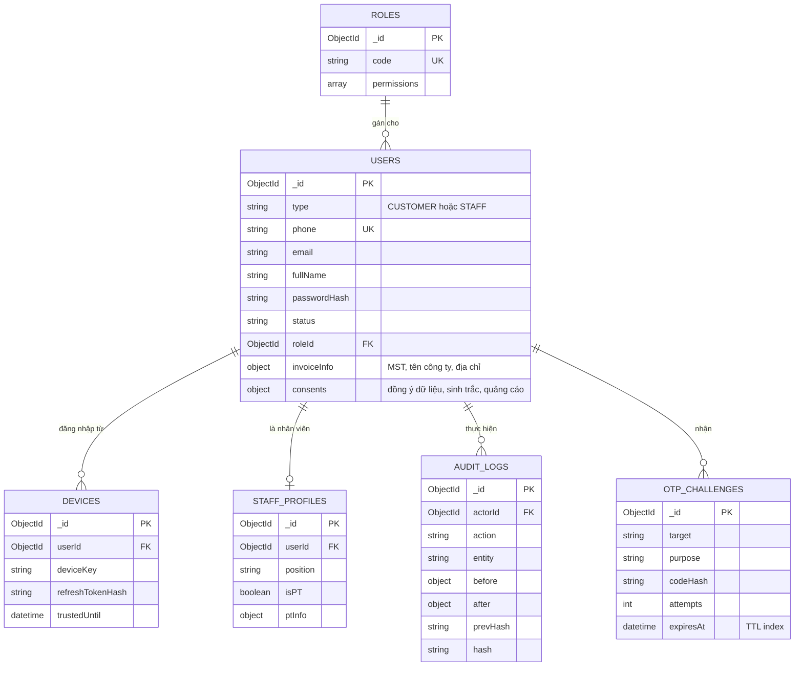

**Nhóm B: Tài nguyên, giá và đặt sân**

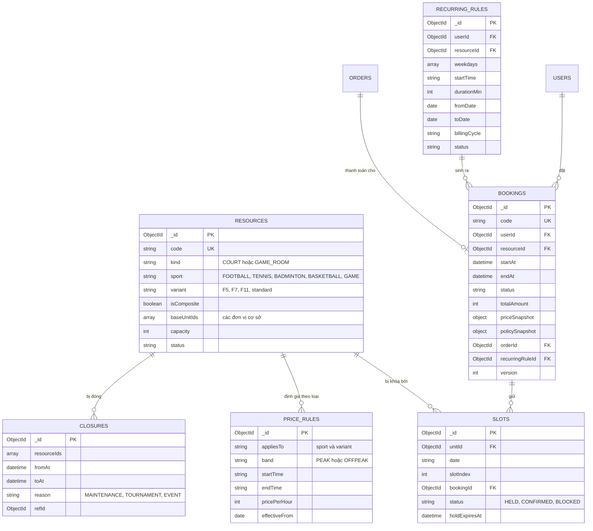

**Nhóm C: Đơn hàng, thanh toán, ví, hóa đơn**

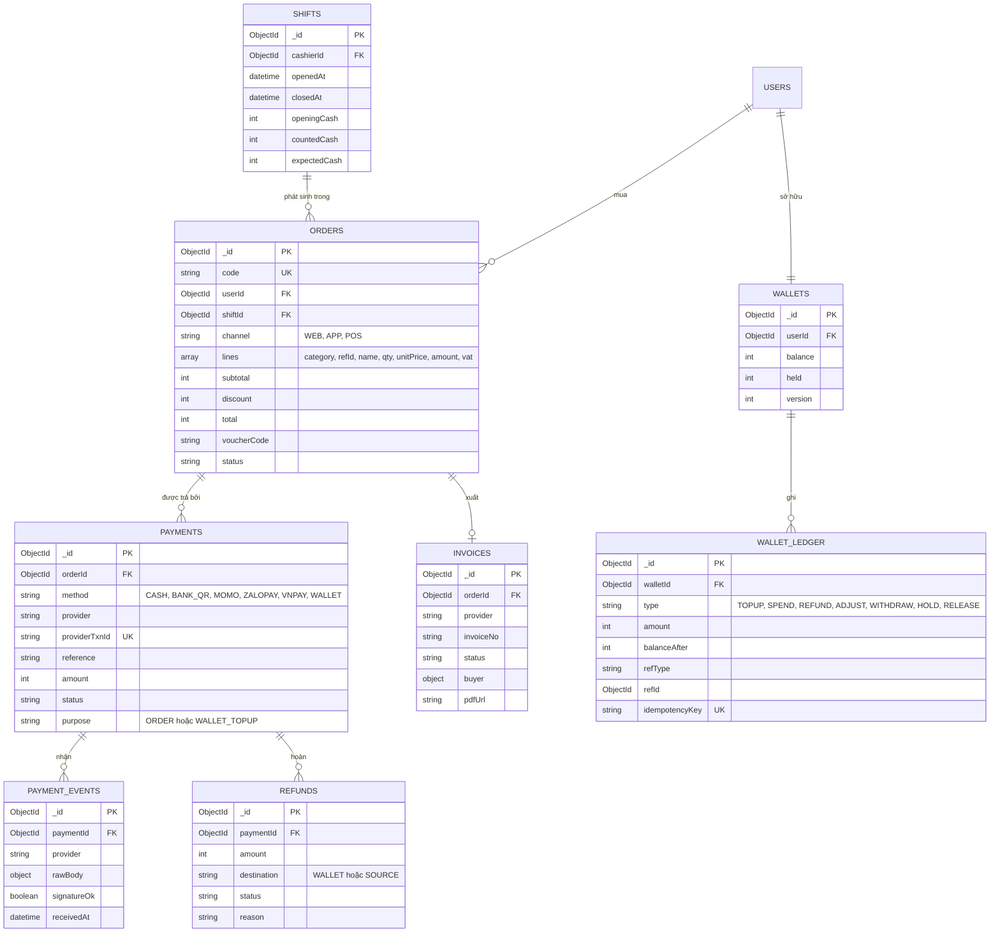

**Nhóm D: Gym, PT và lớp học**

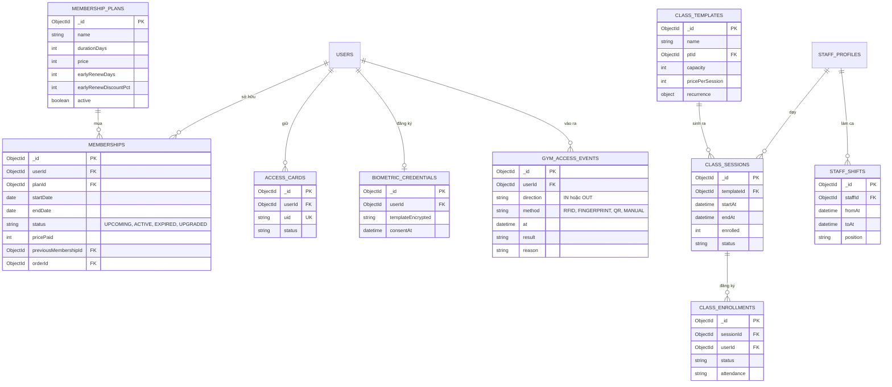

**Nhóm E: Gaming**

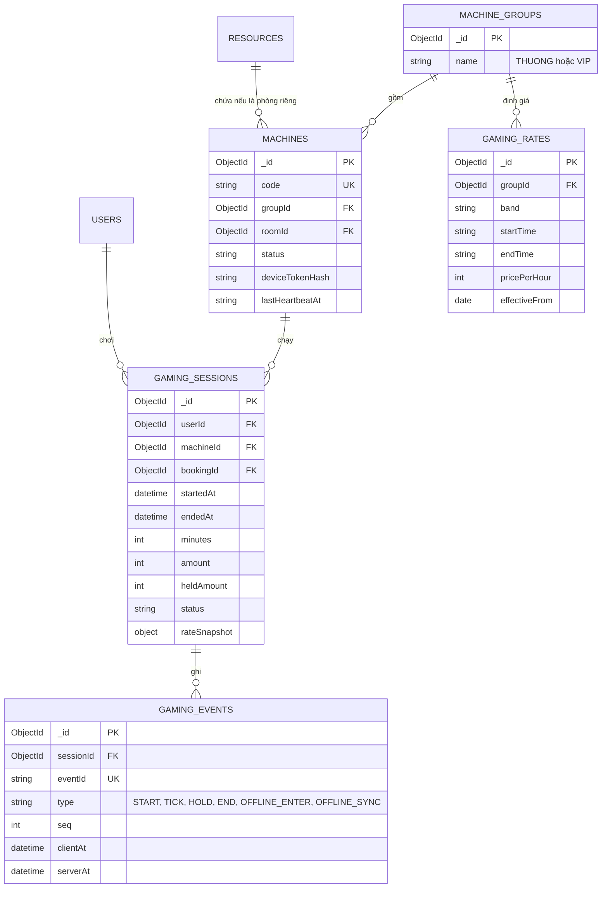

**Nhóm F: Bán lẻ, kho, cho thuê**

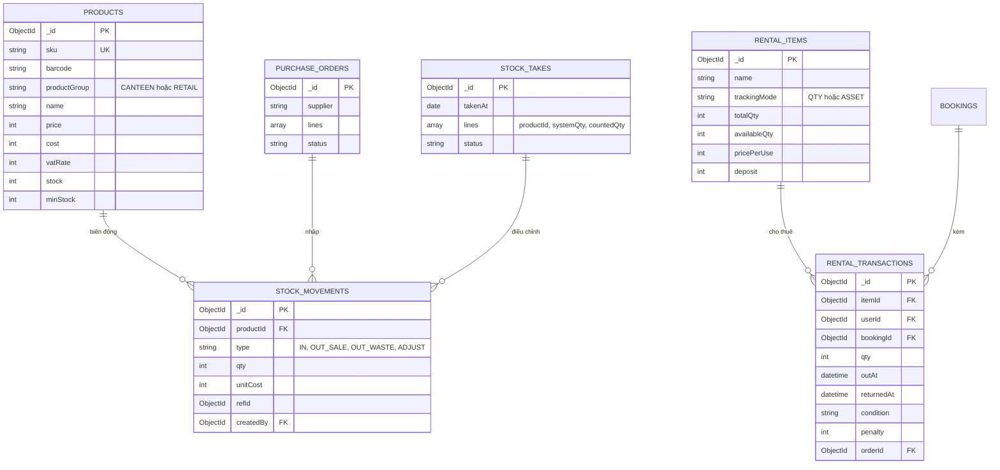

**Nhóm G: Khuyến mãi và giải đấu**

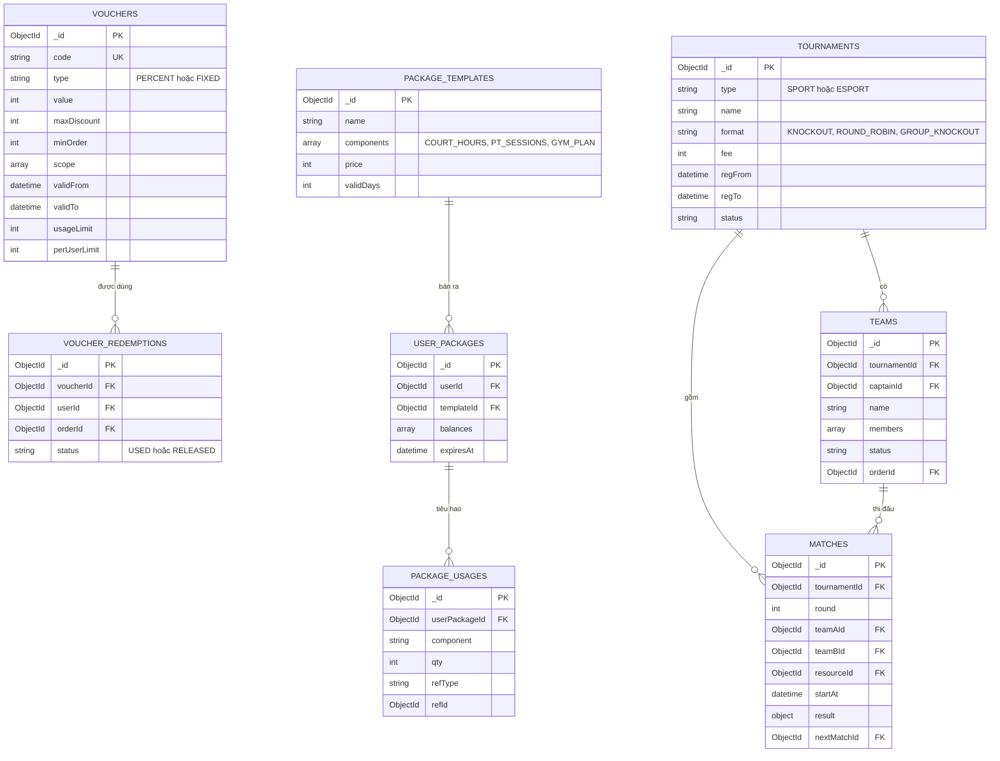

**Nhóm H: Thông báo và hệ thống**

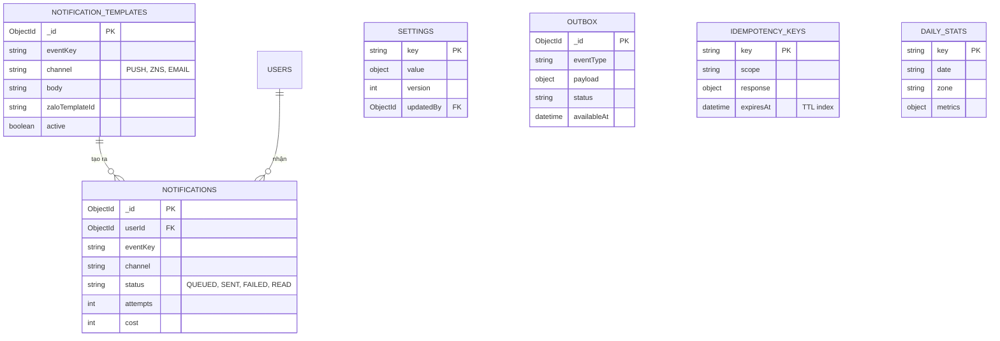

### 5.3 Đặc tả các collection quan trọng

**`slots`** (trái tim của chống trùng lặp)

| Trường | Kiểu | Mô tả |
|---|---|---|
| `unitId` | ObjectId | Đơn vị cơ sở (sân 5, sân tennis, phòng gaming...) |
| `date` | string `YYYY-MM-DD` | Ngày theo múi giờ Việt Nam |
| `slotIndex` | int | Chỉ số ô 30 phút trong ngày (0 đến 47) |
| `bookingId` | ObjectId | Lượt đặt đang giữ ô; với khóa sân thì là mã khóa |
| `status` | enum | `HELD`, `CONFIRMED`, `BLOCKED` |
| `holdExpiresAt` | date | Chỉ có khi `HELD` |

**`bookings`**: các trường chính trong sơ đồ nhóm B, thêm `cancellation { at, by, refundAmount, reason }`, `checkIn { at, method, by }`, `history[]` (đổi lịch), `rentals[]` (tham chiếu phiếu thuê), `source` (`WEB/APP/POS`).

**`orders.lines[]`**: mỗi dòng `{ category, refType, refId, name, qty, unitPrice, amount, vatRate }`, trong đó `category` thuộc: `COURT`, `GAME_TIME`, `GAME_ROOM`, `CANTEEN`, `RETAIL`, `RENTAL`, `GYM_MEMBERSHIP`, `CLASS`, `PT`, `PACKAGE`, `TOURNAMENT_FEE`. Trường `category` quyết định dòng có được trả bằng ví hay không.

**`wallets` và `wallet_ledger`**
- Cập nhật số dư: `updateOne({_id, balance: {$gte: amount}}, {$inc: {balance: -amount}})` trong **cùng transaction** với việc chèn dòng sổ cái. Nếu `matchedCount = 0` thì từ chối.
- `balanceAfter` trong sổ cái cho phép đối soát và truy vết.
- `idempotencyKey` duy nhất để chống ghi hai lần.

**`memberships`**: tại một thời điểm một khách có tối đa một thẻ `ACTIVE`; các thẻ `UPCOMING` nối tiếp nhau (gia hạn cộng dồn tạo thẻ mới bắt đầu ngày sau khi thẻ hiện tại hết).

**`gaming_sessions`**: `heldAmount` là tiền đang tạm giữ chưa quyết toán; `rateSnapshot` lưu bảng giá áp dụng lúc mở phiên và mốc đổi khung giá.

### 5.4 Chỉ mục quan trọng

| Collection | Chỉ mục | Mục đích |
|---|---|---|
| `slots` | **unique** `(unitId, date, slotIndex)` | **Chống đặt trùng** (lớp 3) |
| `slots` | `(status, holdExpiresAt)` | Worker dọn giữ chỗ hết hạn |
| `bookings` | `(userId, startAt desc)` | Lịch sử của khách |
| `bookings` | `(resourceId, startAt)` | Xem lịch theo sân |
| `bookings` | **unique** `code` | Tra cứu bằng mã |
| `payments` | **unique** `(provider, providerTxnId)` (partial, khi có giá trị) | Chống xử lý webhook lặp |
| `payments` | `reference` | Khớp nội dung chuyển khoản |
| `wallet_ledger` | **unique** `idempotencyKey`; `(walletId, createdAt desc)` | Chống ghi lặp; lịch sử ví |
| `wallets` | **unique** `userId` | Mỗi khách một ví |
| `users` | **unique** `phone` (partial), `email` (sparse) | Định danh |
| `memberships` | `(userId, status, endDate)` | Tra cứu thẻ còn hạn |
| `access_cards` | **unique** `uid` | Quét thẻ |
| `gym_access_events` | `(userId, at desc)`, `at` | Lịch sử vào ra, đối chiếu bộ đếm |
| `gaming_sessions` | `(userId, status)` partial `ACTIVE` **unique** | Mỗi khách một phiên đang hoạt động |
| `gaming_events` | **unique** `eventId` | Khử trùng đồng bộ offline |
| `products` | **unique** `sku`; `barcode` | Bán hàng |
| `vouchers` | **unique** `code` | Tra mã |
| `voucher_redemptions` | `(voucherId, userId)` | Kiểm tra giới hạn lượt dùng |
| `audit_logs` | `(entity, createdAt)`, `(actorId, createdAt)` | Truy vết |
| `otp_challenges`, `idempotency_keys` | TTL theo `expiresAt` | Tự xóa dữ liệu tạm |

### 5.5 Các thao tác bắt buộc dùng transaction

| Thao tác | Các collection tham gia |
|---|---|
| Giữ chỗ | `bookings`, `slots` |
| Xác nhận thanh toán | `payments`, `orders`, `bookings`, `slots`, `outbox` |
| Hủy và hoàn tiền | `bookings`, `slots`, `payments`, `refunds`, `wallets`, `wallet_ledger`, `voucher_redemptions` |
| Đổi lịch | `bookings`, `slots` (nhả ô cũ, giữ ô mới), `orders` |
| Trừ ví cho dịch vụ | `wallets`, `wallet_ledger`, `orders` |
| Nâng cấp thẻ gym | `memberships`, `orders`, `payments` |
| Quyết toán phiên gaming | `gaming_sessions`, `wallets`, `wallet_ledger`, `orders` |
| Nhập/xuất kho, bán hàng | `orders`, `products`, `stock_movements` |
| Chốt ca | `shifts`, `orders` (khóa các đơn của ca) |

---

## 6. Danh mục API chính

Tất cả API theo chuẩn REST, tiền tố `/api/v1`, mô tả bằng OpenAPI. Thao tác ghi liên quan tiền hoặc chỗ đặt yêu cầu header `Idempotency-Key`. Dưới đây là nhóm endpoint chính (không liệt kê hết các thao tác CRUD thông thường).

| Module | Endpoint tiêu biểu | Mô tả |
|---|---|---|
| auth | `POST /auth/register`, `/auth/login`, `/auth/otp/send`, `/auth/otp/verify`, `/auth/refresh`, `/auth/logout`, `/auth/password/reset` | Đăng ký, đăng nhập, OTP, làm mới phiên |
| users | `GET/PATCH /me`, `GET /users?phone=`, `POST /users/quick-create`, `PATCH /users/{id}/role` | Hồ sơ, tìm khách, tạo nhanh tại quầy, đổi vai trò |
| facility | `GET /resources`, `GET /price-rules`, `POST /closures`, `GET /closures/{id}/affected-bookings`, `GET/PUT /settings/{key}` | Tài nguyên, giá, khóa sân, cấu hình |
| booking | `GET /availability?date=&sport=`, `POST /bookings/hold`, `POST /bookings/{id}/cancel`, `POST /bookings/{id}/reschedule`, `POST /bookings/{id}/check-in`, `POST /bookings/{id}/extend` | Lịch trống, giữ chỗ, hủy, đổi, check-in, thêm giờ |
| recurring | `POST /recurring-rules`, `POST /recurring-rules/{id}/skip`, `POST /recurring-rules/{id}/renew` | Lịch cố định |
| payment | `POST /payments`, `GET /payments/{id}`, `POST /webhooks/vietqr`, `/webhooks/momo`, `/webhooks/zalopay`, `/webhooks/vnpay`, `POST /refunds`, `GET /reconciliation` | Tạo thanh toán, webhook, hoàn, đối soát |
| wallet | `GET /wallet`, `POST /wallet/topup`, `GET /wallet/ledger`, `POST /wallet/withdraw-requests`, `POST /wallet/adjust` | Ví |
| invoice | `GET /invoices/{id}`, `POST /invoices/{id}/retry`, `GET /invoices/unissued` | Hóa đơn điện tử |
| notification | `GET /notifications`, `PATCH /notifications/{id}/read`, `GET/PUT /notification-templates` | Thông báo |
| membership | `GET /membership-plans`, `POST /memberships`, `POST /memberships/{id}/renew`, `POST /memberships/{id}/upgrade`, `GET /memberships/me` | Thẻ gym |
| gym-access | `POST /gym/access` (bridge, app), `GET /gym/occupancy`, `POST /gym/access/manual`, `POST /access-cards`, `POST /biometrics` | Vào ra, bộ đếm, thẻ, vân tay |
| staff | `GET/POST /staff`, `GET/PUT /staff/{id}/shifts`, `GET /pt`, `POST /pt-sessions` | Nhân sự, ca, PT |
| classes | `GET /classes`, `POST /classes/{id}/enroll`, `POST /classes/sessions/{id}/attendance` | Lớp học |
| pos | `GET /products`, `POST /pos/orders`, `POST /pos/orders/{id}/void`, `POST /pos/shifts/open`, `POST /pos/shifts/{id}/close`, `POST /inventory/receipts`, `POST /inventory/stock-takes` | Bán hàng, ca, kho |
| rental | `GET /rental-items`, `POST /rentals`, `POST /rentals/{id}/return` | Cho thuê dụng cụ |
| gaming | `GET /machines`, `POST /gaming/sessions/start`, `POST /gaming/sessions/{id}/heartbeat`, `POST /gaming/sessions/{id}/end`, `POST /gaming/sync`, `POST /machines/{id}/command` | Máy, phiên, đồng bộ, điều khiển |
| promotion | `POST /vouchers`, `POST /vouchers/validate`, `GET /package-templates`, `POST /packages/purchase`, `GET /packages/me` | Voucher, gói |
| tournament | `GET /tournaments`, `POST /tournaments/{id}/teams`, `POST /tournaments/{id}/draw`, `POST /tournaments/{id}/schedule`, `PATCH /matches/{id}/result` | Giải đấu |
| report | `GET /reports/revenue`, `/reports/occupancy`, `/reports/customers`, `/reports/inventory`, `/reports/shift-reconciliation`, `/reports/gaming`, `/reports/gym`, `/reports/audit` | Báo cáo |
| realtime | `WS /realtime` (kênh `availability`, `gym.occupancy`, `gaming.machines`, `pos.orders`) | Thời gian thực |

---

## 7. Kế hoạch theo giai đoạn

**Tổng thời gian: 44 tuần (khoảng 10 tháng)**, gồm 7 giai đoạn. Cách làm: các giai đoạn chạy tuần tự về mục tiêu, nhưng các hạng mục có thể chạy song song giữa các thành viên (ví dụ nhóm gaming bắt đầu nguyên mẫu từ GĐ2). Mỗi giai đoạn kết thúc bằng một **bản demo chạy được trên môi trường staging** và kiểm tra theo tiêu chí hoàn thành. Việc triển khai thật diễn ra **một lần ở cuối** (go-live), đúng yêu cầu "làm đầy đủ một lần".

> Lịch dưới đây giả định khởi động vào thứ Hai 02/11/2026 chỉ để minh họa. Kỳ nghỉ Tết Nguyên đán 2027 (khoảng đầu tháng 2/2027) rơi vào cuối GĐ2 đến đầu GĐ3, nên cần cộng thêm khoảng 1 đến 2 tuần đệm nếu giữ mốc khởi động này.

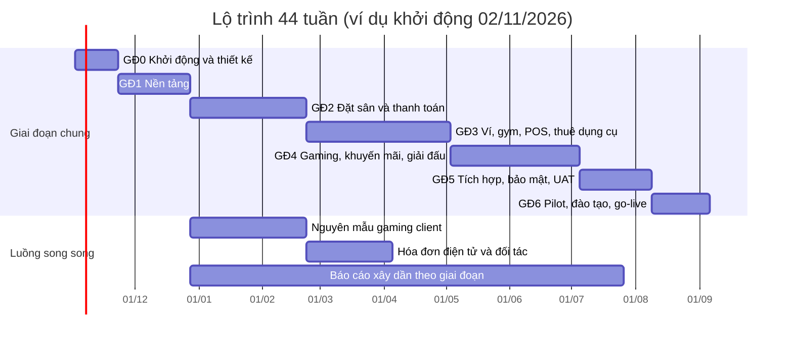

### 7.1 Mốc bàn giao

| Mốc | Cuối tuần | Kết quả có thể xem |
|---|---|---|
| **MS0** | 3 | Hồ sơ thiết kế được duyệt: đặc tả, ERD, thiết kế giao diện, kiến trúc, danh sách thiết bị phần cứng |
| **MS1** | 8 | Alpha nền tảng: đăng ký/đăng nhập, phân quyền, cấu hình tài nguyên và giá, CI/CD, staging |
| **MS2** | 16 | Beta 1: đặt sân đầy đủ (kể cả sân ghép) với thanh toán thật ở sandbox, thông báo, thử tải đặt sân |
| **MS3** | 26 | Beta 2: ví, thẻ gym, kiểm soát vào ra, POS và kho, thuê dụng cụ, PT/lớp, hóa đơn điện tử ở sandbox |
| **MS4** | 35 | Beta 3 (đủ tính năng): gaming đầy đủ, voucher/combo, đặt cố định, giải đấu, báo cáo cơ bản |
| **MS5** | 40 | Bản phát hành ứng viên: qua kiểm thử toàn diện, pentest, thử tải, UAT được chủ ký nhận |
| **MS6** | 44 | Go-live tại cơ sở, 2 tuần hỗ trợ sau triển khai |

### 7.2 Chi tiết từng giai đoạn

#### GĐ0 Khởi động và thiết kế (tuần 1 đến 3)

**Mục tiêu**: chốt phạm vi, thiết kế, và giảm rủi ro kỹ thuật lớn trước khi viết mã chính thức.

| Hạng mục | Nội dung |
|---|---|
| Phân tích | Xác nhận các giả định A01 đến A22 với chủ dự án; viết đặc tả chi tiết có tiêu chí nghiệm thu; sắp xếp thứ tự ưu tiên |
| Thiết kế | Thiết kế giao diện (UI/UX) cho các màn hình chính của 4 kênh; hệ thống thiết kế dùng chung; sơ đồ dữ liệu và API (OpenAPI) bản đầu |
| Nguyên mẫu giảm rủi ro | (1) Kiểm thử tranh chấp: 200 yêu cầu đặt cùng ô trên MongoDB + Redis; (2) Khóa/mở máy từ xa và đồng hồ offline trên 1 máy Windows; (3) Nhận webhook VietQR/ví điện tử ở sandbox; (4) Đọc thẻ RFID/vân tay bằng thiết bị mẫu |
| Hợp đồng đối tác | Mở tài khoản sandbox: đơn vị VietQR, MoMo, ZaloPay, VNPay, nhà cung cấp hóa đơn điện tử, Zalo ZNS/OA; nộp mẫu tin ZNS đi duyệt |
| Phần cứng | Chốt danh sách thiết bị (A15) |
| Quản lý | Quy ước mã nguồn, quy trình review, Definition of Done, backlog trên công cụ quản lý dự án |

**Tiêu chí hoàn thành**: chủ dự án ký duyệt đặc tả và giao diện; 4 nguyên mẫu đạt; danh sách thiết bị được chốt; tài khoản sandbox của các đối tác sẵn sàng.

#### GĐ1 Nền tảng (tuần 4 đến 8)

| Phạm vi | Chi tiết |
|---|---|
| M01 | Kho mã, CI/CD, môi trường dev/staging, khung NestJS, MongoDB replica set, Redis, hàng đợi, logging, idempotency, outbox, sinh kiểu OpenAPI |
| M02 | Đăng ký, đăng nhập, OTP, phiên và thiết bị, RBAC, nhật ký thao tác |
| M03 | Tài nguyên và sân ghép, giờ mở cửa, khung giờ, bảng giá, cấu hình, khóa sân (mức cơ bản) |
| Giao diện | Khung ứng dụng web khách, trang quản trị, POS, app mobile (điều hướng, đăng nhập, hệ thống thiết kế) |
| Hạ tầng | Terraform cho staging; sao lưu; giám sát cơ bản |

**Tiêu chí hoàn thành**: đăng nhập trên cả 4 kênh; chủ cấu hình được sân, giá, khung giờ; mọi thay đổi cấu hình có nhật ký; mỗi lần đẩy mã tự kiểm thử và triển khai lên staging.

#### GĐ2 Đặt sân và thanh toán (tuần 9 đến 16)

| Phạm vi | Chi tiết |
|---|---|
| M04 | Công cụ đặt sân 3 lớp, sân ghép, hủy, đổi lịch, check-in, no-show, thêm giờ, nhắc lịch |
| M06 | Thanh toán tiền mặt, VietQR, MoMo, ZaloPay, VNPay; webhook; đối soát; hoàn tiền vào ví tạm (ghi nhận) |
| M09 | Thông báo push và email; nền tảng ZNS (cấu hình mẫu đã duyệt) |
| Giao diện | Đặt sân trên web, app, POS; lịch quản lý; màn hình thanh toán |
| Song song | Nguyên mẫu Gaming client phát triển tiếp (đăng nhập, khóa màn hình, phiên) |

**Tiêu chí hoàn thành**: kịch bản thử tải đặt sân đạt (200 yêu cầu cùng ô cho đúng 1 thành công; 500 người dùng đồng thời); hủy/đổi lịch/hoàn tiền đúng chính sách; thanh toán muộn xử lý đúng; không phát sinh đặt trùng trong 10.000 lần đặt giả lập.

#### GĐ3 Ví, gym, POS, thuê dụng cụ, PT/lớp, hóa đơn (tuần 17 đến 26)

| Phạm vi | Chi tiết |
|---|---|
| M07 | Ví nội bộ đầy đủ: nạp, trừ, hoàn, điều chỉnh, rút, đối soát số dư |
| M08 | Hóa đơn điện tử tự động qua nhà cung cấp đã chọn |
| M10 | Gói và thẻ gym, mua, gia hạn, nâng cấp, kiểm soát vào ra, bộ đếm 100 người |
| M22 | Bridge agent: RFID, vân tay, QR, cửa, máy in, offline |
| M12 | POS canteen và bán lẻ, kho, nhập/xuất, kiểm kê, ca thu ngân |
| M13 | Cho thuê dụng cụ |
| M11 | Nhân sự, ca, lớp học, PT 1-1 |
| Giao diện | Toàn bộ màn hình tương ứng trên 4 kênh |

**Tiêu chí hoàn thành**: không có đường nào làm số dư ví âm (kiểm thử đồng thời 1.000 thao tác); 150 người cùng quét vào gym khi có 90 người thì đúng 10 người vào; cửa vẫn hoạt động khi ngắt mạng 10 phút; mỗi đơn đã thanh toán có hóa đơn điện tử ở sandbox; chốt ca khớp tiền.

#### GĐ4 Gaming, khuyến mãi, đặt cố định, giải đấu (tuần 27 đến 35)

| Phạm vi | Chi tiết |
|---|---|
| M14 | Gaming server và client hoàn chỉnh: phiên, tạm giữ tiền, điều khiển từ xa, sơ đồ máy, phòng riêng, offline, chống can thiệp, cập nhật tự động |
| M15 | Voucher và gói combo |
| M05 | Đặt sân cố định |
| M16 | Giải đấu thể thao, esports, nhánh đấu, trang công khai |
| M17 | Hoàn thiện các báo cáo R1 đến R9 |
| Giao diện | Màn hình gaming, giải đấu, voucher, combo, báo cáo |

**Tiêu chí hoàn thành**: thử trên **20 máy thật** chạy liên tục 3 ngày; ngắt mạng ngẫu nhiên mà số tiền vẫn khớp từng phút; lịch cố định 12 tuần sinh đúng và xử lý được xung đột; một giải thử với 8 đội chạy hết từ đăng ký đến nhập kết quả.

#### GĐ5 Tích hợp, bảo mật, thử tải, UAT (tuần 36 đến 40)

| Hạng mục | Nội dung |
|---|---|
| Kiểm thử toàn hệ thống | Kịch bản đầu-cuối cho mọi luồng; hồi quy tự động |
| Hiệu năng | Thử tải theo mục 3.9; điều chỉnh chỉ mục và bộ nhớ đệm |
| Bảo mật | Kiểm thử xâm nhập bởi bên thứ ba, sửa lỗi; rà soát quyền; thử khôi phục từ sao lưu |
| Hóa đơn và thanh toán | Chuyển từ sandbox sang môi trường thật của nhà cung cấp, thử giao dịch tiền thật giá trị nhỏ |
| Dữ liệu khởi tạo | Nhập tài nguyên, giá, sản phẩm, nhân viên, mẫu tin, chính sách thật |
| UAT | Chủ và nhân viên tự chạy các kịch bản thực tế; thu lỗi và xử lý theo mức ưu tiên |

**Tiêu chí hoàn thành**: không còn lỗi mức nghiêm trọng hoặc cao; pentest không còn lỗ hổng cao; khôi phục thử thành công trong thời gian RTO; chủ ký nghiệm thu UAT.

#### GĐ6 Pilot, đào tạo, go-live (tuần 41 đến 44)

| Tuần | Hoạt động |
|---|---|
| 41 | Lắp đặt thiết bị tại cơ sở, cài Gaming client trên toàn bộ 70 máy, cài bridge agent, kiểm tra mạng và đường truyền dự phòng; đào tạo nhân viên theo vai trò |
| 42 | **Chạy thử** (soft launch) với nhóm khách mời hoặc một số khu; theo dõi sát, sửa lỗi nhanh |
| 43 | **Go-live toàn bộ**; đội trực tại chỗ |
| 44 | Hỗ trợ sau triển khai (hypercare), chốt danh sách việc tồn đọng, bàn giao tài liệu và quy trình vận hành |

**Tiêu chí hoàn thành**: vận hành ổn định 7 ngày liên tiếp không có sự cố nghiêm trọng; nhân viên tự thao tác thạo; tài liệu bàn giao đủ.

---

## 8. Phân bổ công việc cho 7 thành viên

### 8.1 Vai trò và kỹ năng yêu cầu

| Mã | Vai trò | Kỹ năng chính | Phụ trách |
|---|---|---|---|
| **T1** | Tech Lead, Backend lõi | NestJS, MongoDB (transaction, index), Redis, kiến trúc, đồng thời | Kiến trúc, nền tảng, xác thực/phân quyền, **công cụ đặt sân 3 lớp**, review mã toàn dự án |
| **T2** | Backend Thanh toán và Tài chính | NestJS, tích hợp cổng thanh toán, webhook, kế toán cơ bản | Thanh toán, ví, hóa đơn điện tử, thông báo, khuyến mãi |
| **T3** | Backend Nghiệp vụ | NestJS, MongoDB, thiết kế nghiệp vụ | Cơ sở vật chất, đặt cố định, gym, POS và kho, cho thuê dụng cụ |
| **T4** | Frontend Web | Next.js, React, TypeScript, biểu đồ | Web khách, trang quản trị, báo cáo |
| **T5** | Mobile và POS | React Native, React, TypeScript | App mobile, giao diện POS, giải đấu, lớp học/PT |
| **T6** | Gaming và Thiết bị | C#/.NET (WPF), Windows internals, WebSocket, SDK thiết bị | Gaming client, gaming server, bridge agent, esports |
| **T7** | QA và DevOps | Kiểm thử tự động, k6, Terraform, Docker, CI/CD, giám sát, bảo mật | Chiến lược kiểm thử, tự động hóa, hạ tầng, sao lưu, pentest, triển khai |

Ngoài 7 thành viên: **Product Owner** (chủ dự án hoặc người được ủy quyền) và **UI/UX designer** thuê ngoài khoảng 6 tuần (A16, A17). T1 kiêm vai trò điều phối kỹ thuật và quản lý tiến độ hằng ngày.

### 8.2 Khối lượng theo module (ngày công)

Đơn vị là **ngày công thực làm** (đã gồm lập trình, kiểm thử đơn vị, review). Tổng 1.250 ngày công cho các module và 20 ngày điều phối/review của Tech Lead.

| Module | Nội dung | Ngày công | Người phụ trách chính | Ưu tiên |
|---|---|---:|---|---|
| M01 | Nền tảng kỹ thuật | 30 | T1 | M |
| M02 | Định danh, xác thực, phân quyền | 45 | T1 | M |
| M03 | Cơ sở vật chất, giá, cấu hình | 35 | T3 | M |
| M04 | Đặt sân (công cụ 3 lớp) | 90 | T1 | M |
| M05 | Đặt sân cố định | 20 | T3 | S |
| M06 | Thanh toán | 50 | T2 | M |
| M07 | Ví nội bộ | 30 | T2 | M |
| M08 | Hóa đơn điện tử | 25 | T2 | M |
| M09 | Thông báo | 30 | T2 | M |
| M10 | Gym và kiểm soát vào ra (server) | 60 | T3 | M |
| M11 | PT, lớp học, nhân sự | 35 | T5 (25), T4 (10) | S |
| M12 | POS, kho, ca (server) | 45 | T3 | M |
| M13 | Cho thuê dụng cụ | 20 | T3 | S |
| M14a | Gaming server | 55 | T6 | M |
| M14b | Gaming client | 80 | T6 | M |
| M15 | Voucher và combo | 35 | T2 | S |
| M16 | Giải đấu | 55 | T5 (35), T6 (20) | S |
| M17 | Báo cáo và bảng điều khiển | 45 | T4 | M |
| M18 | Web khách | 65 | T4 | M |
| M19 | Trang quản trị | 65 | T4 | M |
| M20 | App mobile | 75 | T5 | M |
| M21 | Giao diện POS | 50 | T5 | M |
| M22 | Bridge agent và thiết bị | 30 | T6 | M |
| M23 | Kiểm thử và tự động hóa | 110 | T7 | M |
| M24 | DevOps, bảo mật, giám sát | 40 | T7 | M |
| M25 | Triển khai, đào tạo, tài liệu | 30 | T7 (các thành viên khác hỗ trợ đào tạo theo vai trò, tính trong ngày công GĐ6 của họ) | M |
| | **Tổng module** | **1.250** | | |
| | Điều phối, review kỹ thuật của Tech Lead | 20 | T1 | |
| | **Tổng cộng** | **1.270** | | |

> Ghi chú: M10, M12 ghi ngày công của phần máy chủ; phần giao diện của hai module này nằm trong M18, M19, M20, M21.

### 8.3 Tải của từng thành viên

Khả năng cung cấp ước tính: 44 tuần × 5 ngày = 220 ngày, trừ khoảng 15% nghỉ phép, họp, hỗ trợ lẫn nhau ≈ **187 ngày** công tác thực mỗi người.

| Thành viên | Module và khối lượng | Tổng ngày công | So với khả năng 187 |
|---|---|---:|---:|
| T1 | M01 (30) + M02 (45) + M04 (90) + điều phối/review (20) | 185 | 99% |
| T2 | M06 (50) + M07 (30) + M08 (25) + M09 (30) + M15 (35) | 170 | 91% |
| T3 | M03 (35) + M05 (20) + M10 (60) + M12 (45) + M13 (20) | 180 | 96% |
| T4 | M17 (45) + M18 (65) + M19 (65) + M11 giao diện (10) | 185 | 99% |
| T5 | M20 (75) + M21 (50) + M16 (35) + M11 (25) | 185 | 99% |
| T6 | M14a (55) + M14b (80) + M22 (30) + M16 esports (20) | 185 | 99% |
| T7 | M23 (110) + M24 (40) + M25 triển khai, đào tạo, tài liệu (30) | 180 | 96% |
| **Tổng** | | **1.270** | |

> **Độ đầy của đội gần 100%**, nghĩa là gần như không có dự phòng; xem mục 11 và 12 về cách xử lý.

### 8.4 Ma trận ngày công theo giai đoạn

| Thành viên | GĐ0 (3 tuần) | GĐ1 (5) | GĐ2 (8) | GĐ3 (10) | GĐ4 (9) | GĐ5 (5) | GĐ6 (4) | Tổng |
|---|---:|---:|---:|---:|---:|---:|---:|---:|
| T1 | 12 | 25 | 40 | 36 | 28 | 24 | 20 | 185 |
| T2 | 8 | 14 | 40 | 42 | 36 | 18 | 12 | 170 |
| T3 | 10 | 20 | 30 | 52 | 36 | 18 | 14 | 180 |
| T4 | 12 | 20 | 36 | 40 | 40 | 22 | 15 | 185 |
| T5 | 10 | 18 | 36 | 42 | 42 | 20 | 17 | 185 |
| T6 | 10 | 15 | 30 | 40 | 50 | 24 | 16 | 185 |
| T7 | 10 | 28 | 28 | 36 | 36 | 26 | 16 | 180 |
| **Cộng** | **72** | **140** | **240** | **288** | **268** | **152** | **110** | **1.270** |

### 8.5 Công việc chi tiết từng thành viên theo giai đoạn

#### T1: Tech Lead, Backend lõi

| GĐ | Công việc |
|---|---|
| GĐ0 | Thiết kế kiến trúc và sơ đồ dữ liệu; nguyên mẫu kiểm thử tranh chấp đặt chỗ 3 lớp; quy ước mã nguồn và quy trình review; chủ trì chốt giả định kỹ thuật |
| GĐ1 | Khung NestJS, kết nối MongoDB/Redis, idempotency, outbox, logging; M02 hoàn chỉnh (đăng ký, đăng nhập, OTP, phiên, RBAC, audit) |
| GĐ2 | M04: giữ chỗ, sân ghép, transaction, hủy, đổi lịch, check-in, no-show, thêm giờ; tối ưu chỉ mục; hỗ trợ T2 ráp thanh toán xác nhận |
| GĐ3 | Review bảo mật module tiền; hỗ trợ M10 (bộ đếm Lua) và đối soát ví; tối ưu hiệu năng |
| GĐ4 | Hỗ trợ M14 đồng bộ offline; tích hợp khóa tài nguyên cho M16 và M05 với công cụ đặt chỗ |
| GĐ5 | Dẫn đầu thử tải, sửa lỗi hiệu năng và lỗi nghiêm trọng; rà soát bảo mật cùng T7 |
| GĐ6 | Trực kỹ thuật go-live, xử lý sự cố, bàn giao kỹ thuật |

#### T2: Backend Thanh toán và Tài chính

| GĐ | Công việc |
|---|---|
| GĐ0 | Mở tài khoản sandbox các đối tác; nguyên mẫu webhook VietQR/ví điện tử; chọn nhà cung cấp hóa đơn điện tử |
| GĐ1 | Khung module payment, notification (hàng đợi, mẫu); nộp mẫu ZNS đi duyệt |
| GĐ2 | M06: tiền mặt, VietQR, MoMo, ZaloPay, VNPay, webhook, khử trùng, `MISMATCH`, hoàn tiền; M09 push/email/ZNS và nhắc lịch |
| GĐ3 | M07 ví (sổ cái, trừ có điều kiện, nạp, rút, điều chỉnh, đối soát); M08 hóa đơn điện tử (adapter, hàng đợi, hủy/điều chỉnh) |
| GĐ4 | M15 voucher, gói combo, quy tắc ví theo danh mục; chuẩn bị thanh toán lệ phí giải; thanh toán tại màn hình gaming |
| GĐ5 | Chuyển sang môi trường thật của cổng và nhà cung cấp hóa đơn; thử tiền thật; đối soát cuối |
| GĐ6 | Theo dõi thanh toán, hóa đơn trong những ngày đầu; xử lý giao dịch không khớp |

#### T3: Backend Nghiệp vụ

| GĐ | Công việc |
|---|---|
| GĐ0 | Phân tích nghiệp vụ gym, kho, cho thuê; chuẩn bị danh mục dữ liệu khởi tạo |
| GĐ1 | M03: tài nguyên, sân ghép, giờ mở cửa, khung giờ, bảng giá, khóa sân, cấu hình |
| GĐ2 | Hoàn thiện khóa sân và xử lý xung đột; bắt đầu mô hình dữ liệu gym; hỗ trợ M04 phần giá và sân ghép |
| GĐ3 | M10 gói và thẻ gym, gia hạn, nâng cấp, kiểm soát vào ra, bộ đếm; M12 sản phẩm, kho, nhập/xuất, kiểm kê, ca; M13 dụng cụ cho thuê |
| GĐ4 | M05 đặt sân cố định; hỗ trợ nghiệp vụ gym cho báo cáo; hỗ trợ M16 xếp lịch |
| GĐ5 | Sửa lỗi UAT các module mình phụ trách; nhập dữ liệu thật |
| GĐ6 | Hỗ trợ nghiệp vụ tại quầy, sửa lỗi nóng |

#### T4: Frontend Web

| GĐ | Công việc |
|---|---|
| GĐ0 | Cùng designer chốt hệ thống thiết kế; bộ thư viện giao diện dùng chung; mẫu giao diện web |
| GĐ1 | Khung web khách và quản trị; đăng ký/đăng nhập/OTP; quản lý tài nguyên, giá, cấu hình |
| GĐ2 | Lịch trống, đặt sân, thanh toán, lượt đặt của tôi trên web; lịch quản lý, quản lý khách, màn hình thanh toán và đối soát |
| GĐ3 | Ví, thẻ gym (mua, gia hạn, nâng cấp, QR, số người đang tập); trang quản trị gym, kho, nhân sự, lớp; hóa đơn; giao diện lớp học (phần web) |
| GĐ4 | Gaming (đặt phòng, nạp tiền, lịch sử); sơ đồ máy cho quản trị; voucher, combo; trang giải đấu công khai; **toàn bộ báo cáo R1 đến R9 và bảng điều khiển** |
| GĐ5 | Hoàn thiện, khả năng truy cập, hiệu năng trình duyệt, sửa lỗi UAT |
| GĐ6 | Hỗ trợ, tài liệu hướng dẫn cho quản trị |

#### T5: Mobile và POS

| GĐ | Công việc |
|---|---|
| GĐ0 | Khung React Native, chọn thư viện (điều hướng, quét QR, push), nguyên mẫu quét QR |
| GĐ1 | Điều hướng, đăng nhập/OTP, nhận push; khung POS (đăng nhập, mở ca) |
| GĐ2 | Đặt sân, thanh toán, lượt đặt, QR check-in trên app; POS đặt sân hộ, check-in |
| GĐ3 | App: ví, thẻ gym, QR vào gym, số người đang tập, lớp học, PT; POS: bán hàng, ca, thuê dụng cụ, mua thẻ gym, nạp ví; M11 lớp học và PT (phần backend 25 ngày) |
| GĐ4 | App: gaming (phòng riêng, QR đăng nhập máy), giải đấu (đăng ký đội, nhánh đấu); **M16 giải đấu (đăng ký, bốc thăm, xếp lịch, kết quả)**; POS: quản lý máy gaming |
| GĐ5 | Đưa app lên TestFlight và Google Play nội bộ; sửa lỗi; chuẩn bị hồ sơ duyệt cửa hàng ứng dụng |
| GĐ6 | Phát hành lên App Store và Google Play; hỗ trợ đào tạo POS |

#### T6: Gaming và Thiết bị

| GĐ | Công việc |
|---|---|
| GĐ0 | Nguyên mẫu khóa/mở máy từ xa, đồng hồ offline; thử đầu đọc RFID/vân tay mẫu |
| GĐ1 | Khung Gaming client (khóa màn hình, kết nối WebSocket, đăng ký thiết bị); khung bridge agent |
| GĐ2 | Nguyên mẫu phiên chơi (đăng nhập, đồng hồ, kết thúc); module server `gaming` phần nền |
| GĐ3 | **M22 bridge agent đầy đủ**: RFID, vân tay, QR, cửa, máy in, offline, đồng bộ; hỗ trợ M10 phần kiểm soát vào ra |
| GĐ4 | **M14 đầy đủ**: tạm giữ tiền, cảnh báo, hết tiền, chuyển máy, điều khiển từ xa, sơ đồ máy, phòng riêng, offline đầy đủ, chống can thiệp, cập nhật tự động; esports chế độ giải; thử 20 máy 3 ngày |
| GĐ5 | Thử mất điện/mất mạng hàng loạt; tối ưu; sửa lỗi |
| GĐ6 | Cài đặt trên 70 máy, trực khu gaming, hỗ trợ sự cố thiết bị |

#### T7: QA và DevOps

| GĐ | Công việc |
|---|---|
| GĐ0 | Chiến lược kiểm thử, môi trường, công cụ; tiêu chí nghiệm thu; chuẩn bị Terraform |
| GĐ1 | CI/CD, môi trường dev/staging, sao lưu, giám sát cơ bản; bộ kiểm thử API tự động đầu tiên |
| GĐ2 | Kiểm thử tranh chấp đặt chỗ, thanh toán, hồi quy tự động cho M04, M06; kiểm thử giao diện (Playwright) |
| GĐ3 | Kiểm thử ví đồng thời, bộ đếm gym, offline cửa; kiểm thử POS và kho; chuẩn bị môi trường production |
| GĐ4 | Kiểm thử gaming (mất mạng, mất điện), giải đấu, đặt cố định; chuẩn bị thử tải |
| GĐ5 | Thử tải (k6), điều phối pentest, thử khôi phục, môi trường production, quét bảo mật; tổ chức UAT |
| GĐ6 | Triển khai production, giám sát go-live, quy trình trực, hỗ trợ đào tạo |

### 8.6 Phối hợp và quy trình làm việc

| Hạng mục | Quy ước |
|---|---|
| Nhịp làm việc | Sprint 2 tuần; họp lập kế hoạch đầu sprint, demo và rà soát cuối sprint; họp đứng 15 phút mỗi ngày |
| Quản lý công việc | Backlog theo module, mỗi công việc có tiêu chí nghiệm thu |
| Mã nguồn | Một kho mã (monorepo) cho backend, web, mobile, thư viện dùng chung; kho riêng cho gaming client và bridge agent; nhánh theo tính năng, review bắt buộc bởi ít nhất một người khác; Tech Lead review mọi thay đổi chạm vào tiền và đặt chỗ |
| Definition of Done | Mã được review; có kiểm thử đơn vị và tích hợp; tài liệu API cập nhật; qua CI; demo được trên staging; QA xác nhận theo tiêu chí nghiệm thu |
| Phụ thuộc chặn | T1 giao hợp đồng API (OpenAPI) trước mỗi giai đoạn để T4, T5 làm giao diện song song với backend, dùng máy chủ giả lập (mock) |
| Hỏi đáp PO | Câu hỏi nghiệp vụ trả lời trong 2 ngày làm việc; quyết định ghi vào nhật ký quyết định |
| Giảm "điểm đơn" nhân sự | Mỗi module có người phụ trách chính và người dự phòng: T1↔T3 (booking, gym), T2↔T1 (thanh toán, ví), T4↔T5 (giao diện), T6↔T7 (thiết bị, kiểm thử) |

---

## 9. Kế hoạch kiểm thử và chất lượng

### 9.1 Các tầng kiểm thử

| Tầng | Công cụ | Phạm vi | Chịu trách nhiệm |
|---|---|---|---|
| Đơn vị | Jest (backend, web), xUnit/NUnit (.NET) | Logic giá, hoàn tiền, nâng cấp thẻ, tính tiền gaming, sân ghép | Lập trình viên |
| Tích hợp API | Jest + Supertest, MongoDB và Redis thật (container) | Luồng nghiệp vụ qua API, transaction, ràng buộc unique | Lập trình viên + QA |
| Giao diện đầu-cuối | Playwright (web, POS), Maestro hoặc Detox (mobile) | Luồng chính của khách và nhân viên | QA |
| Tranh chấp đồng thời | Kịch bản riêng bằng k6 hoặc script | Đặt trùng, ví, bộ đếm gym, webhook lặp | QA + Tech Lead |
| Hiệu năng | k6 | Tải theo mục 3.9 | QA + DevOps |
| Thiết bị và offline | Bài thử thực tế trên máy và thiết bị | Gaming client, cửa gym, máy in, mất mạng/mất điện | T6 + QA |
| Bảo mật | OWASP ZAP trong CI, pentest bên ngoài | Xác thực, phân quyền, webhook, rò rỉ dữ liệu | DevOps + bên thứ ba |
| Chấp nhận (UAT) | Kịch bản thực tế do chủ và nhân viên thực hiện | Toàn bộ nghiệp vụ | Product Owner + nhân viên |

### 9.2 Kịch bản bắt buộc phải qua (tiêu chí chặn go-live)

| Mã | Kịch bản | Tiêu chí đạt |
|---|---|---|
| T01 | 200 yêu cầu đặt cùng một ô cùng lúc | Đúng 1 thành công, 199 báo trùng, không có bản ghi hỏng |
| T02 | Đặt sân 11, sau đó đặt sân 7 và sân 5 cùng khung giờ trong cụm | Các lần đặt sau bị từ chối đúng |
| T03 | Đặt sân 5 rồi đặt sân 11 chứa nó | Sân 11 bị từ chối |
| T04 | Webhook thanh toán gửi lặp 10 lần | Chỉ xác nhận một lần, số dư/đơn đúng |
| T05 | Chuyển khoản sau khi giữ chỗ hết hạn | Ô còn trống thì xác nhận; đã mất thì hoàn vào ví và báo khách |
| T06 | Chuyển khoản sai số tiền | Vào trạng thái `MISMATCH`, không tự xác nhận |
| T07 | 1.000 thao tác trừ ví đồng thời trên một ví | Số dư cuối khớp tổng sổ cái, không âm |
| T08 | Hủy trước 24 giờ và sau 24 giờ | Hoàn đúng 100% và 0 đồng theo chính sách |
| T09 | 150 người quét vào gym khi có 90 người | Đúng 10 người vào, bộ đếm 100 |
| T10 | Ngắt mạng cửa gym 10 phút | Thành viên hợp lệ vẫn vào được, đồng bộ lại đúng |
| T11 | Ngắt mạng một máy gaming đang chơi 10 phút rồi nối lại | Số tiền khớp từng phút, số dư không âm |
| T12 | Máy gaming bị rút điện đột ngột | Phiên kết thúc theo heartbeat cuối, không tính thừa |
| T13 | Một tài khoản đăng nhập 2 máy gaming | Lần thứ hai bị từ chối |
| T14 | Nâng cấp thẻ gym giữa chừng | Tiền chênh lệch và ngày hiệu lực đúng công thức |
| T15 | Quản lý khóa sân trùng nhiều lượt đã đặt | Danh sách ảnh hưởng đúng, không lượt nào tự mất |
| T16 | Thu ngân bán hàng khi chưa mở ca; chốt ca có chênh lệch | Bị chặn; chênh lệch hiển thị đúng |
| T17 | Thu ngân gọi API doanh thu tổng | Bị từ chối (403) |
| T18 | Khôi phục cơ sở dữ liệu từ sao lưu | Khôi phục đúng trong RTO, mất dữ liệu trong RPO |
| T19 | Tải 500 người dùng đồng thời và 70 máy gaming | p95 trong mục tiêu, không lỗi dây chuyền |
| T20 | Mỗi đơn đã thanh toán có hóa đơn điện tử | Báo cáo R8 không còn đơn thiếu hóa đơn |

### 9.3 Quản lý lỗi

| Mức | Định nghĩa | Thời hạn xử lý |
|---|---|---|
| Nghiêm trọng | Sai tiền, mất dữ liệu, đặt trùng, không vận hành được | Sửa ngay, trong 24 giờ |
| Cao | Chức năng chính hỏng, có cách tạm thời | Trong 3 ngày làm việc |
| Trung bình | Chức năng phụ hỏng | Trong sprint kế tiếp |
| Thấp | Lỗi giao diện nhỏ | Theo backlog |

Điều kiện phát hành: không còn lỗi nghiêm trọng hoặc cao; mọi kịch bản mục 9.2 đạt.

---

## 10. Triển khai, vận hành, đào tạo

### 10.1 Quy trình phát hành

1. Mỗi thay đổi đi qua nhánh tính năng, pull request, review, CI tự động (kiểm thử, quét bảo mật).
2. Hợp nhất vào nhánh chính thì tự triển khai lên **staging**; QA xác nhận.
3. Phát hành lên **production** bằng cách cuốn chiếu (rolling), có khả năng quay lui (rollback) trong vài phút. Cập nhật cơ sở dữ liệu theo kiểu tương thích ngược.
4. Gaming client và bridge agent cập nhật theo đợt (một nhóm máy trước, nhóm còn lại sau), ngoài giờ cao điểm.
5. App mobile phát hành qua App Store và Google Play (thời gian duyệt cần tính trước khoảng 1 đến 2 tuần cho lần đầu).

### 10.2 Sao lưu và khôi phục

| Hạng mục | Chính sách |
|---|---|
| MongoDB | Snapshot hằng ngày giữ 30 ngày + sao lưu liên tục điểm-thời-gian (PITR) giữ 7 ngày; tách riêng vùng lưu |
| Redis | Bật persistence; dữ liệu trong Redis có thể tái tạo từ MongoDB |
| Tệp (ảnh, hóa đơn PDF) | Lưu trên object storage có phiên bản và nhân bản |
| Thử khôi phục | Mỗi quý một lần, có biên bản |

### 10.3 Giám sát và cảnh báo

| Cảnh báo | Điều kiện | Người nhận |
|---|---|---|
| Webhook thanh toán lỗi hoặc chậm | Tỷ lệ lỗi trên 2% trong 5 phút | T2, T7 |
| Giao dịch `MISMATCH` mới | Mỗi giao dịch | Quản lý |
| Hóa đơn điện tử lỗi quá số lần thử | Mỗi hóa đơn | Kế toán, T2 |
| Hàng đợi tắc | Số việc chờ quá ngưỡng | T7 |
| Chênh lệch số dư ví khi đối soát | Bất kỳ | Chủ, T2 |
| Máy gaming mất kết nối | Quá 3 phút | Quản lý, thu ngân |
| Thiết bị cửa hoặc đầu đọc lỗi | Mất heartbeat | Quản lý, thu ngân |
| Gym gần đầy | Trên 90 người | Quản lý |
| Tồn kho thấp | Dưới ngưỡng | Quản lý |
| Tỷ lệ lỗi API, độ trễ, CPU, bộ nhớ, dung lượng DB | Vượt ngưỡng | T7, T1 |

### 10.4 Quy trình xử lý sự cố thường gặp (runbook)

| Sự cố | Cách xử lý ngắn gọn |
|---|---|
| Mất Internet tại cơ sở | Chuyển đường truyền dự phòng; gaming client chạy offline đến hết phần tạm giữ; cửa gym chạy bằng danh sách cục bộ; POS dùng ghi nhận thủ công tạm thời, nhập lại khi có mạng |
| Cổng thanh toán lỗi | Tạm ẩn phương thức lỗi, thu bằng phương thức khác; đối soát sau khi cổng hoạt động lại |
| Khách chuyển khoản nhưng chưa thấy xác nhận | Tra cứu giao dịch trong màn hình thanh toán; quản lý xác nhận thủ công có bút toán và nhật ký |
| Số người gym hiển thị sai | Quản lý chạy "đối chiếu bộ đếm" từ lịch sử vào ra |
| Hóa đơn điện tử lỗi | Thử lại thủ công hoặc xuất bù theo quy trình nhà cung cấp |
| Máy gaming treo | Thu ngân kết thúc phiên từ xa, tiền tính đến mốc heartbeat cuối |

### 10.5 Đào tạo và tài liệu

| Đối tượng | Nội dung | Thời lượng |
|---|---|---|
| Chủ cơ sở | Bảng điều khiển, báo cáo, quyền, xử lý ngoại lệ | 2 giờ |
| Quản lý | Cấu hình giá/lịch/chính sách, khóa sân, nhân sự, duyệt hoàn/rút ví, voucher, giải đấu, đối soát | 6 giờ |
| Thu ngân/lễ tân | POS, mở/chốt ca, đặt sân hộ, check-in, nạp ví, gym, thuê dụng cụ, hoàn/hủy, xử lý sự cố | 8 giờ + thực hành 1 ca |
| PT | Lịch dạy, học viên, điểm danh | 1 giờ |
| Khách hàng | Hướng dẫn trong app và web, tài liệu ngắn tại quầy | Không |

Tài liệu bàn giao: hướng dẫn sử dụng theo vai trò (kèm ảnh), tài liệu API, sơ đồ kiến trúc và dữ liệu, hướng dẫn triển khai và vận hành, runbook, danh sách tài khoản và bí mật (lưu trong kho bí mật), nhật ký quyết định.

### 10.6 Hỗ trợ sau go-live

2 tuần hypercare có đội trực (đủ T1, T6, T7 và một người cho mỗi mảng chính); sau đó chuyển sang bảo trì: cần tối thiểu 1 đến 2 kỹ sư có hiểu hệ thống để trực xử lý sự cố, cập nhật hàng tháng và vá bảo mật (chi phí duy trì xem mục 12).

---

## 11. Rủi ro và biện pháp giảm thiểu

| Mã | Rủi ro | Xác suất | Ảnh hưởng | Biện pháp | Người phụ trách |
|---|---|---|---|---|---|
| R01 | **Khối lượng lớn so với 7 người**, đội gần 100% công suất, không có dự phòng | Cao | Cao | Theo dõi tiến độ theo sprint; sẵn danh sách cắt giảm theo ưu tiên (mục 12.3); không nhận thêm yêu cầu ngoài kế hoạch nếu không đánh đổi | T1, PO |
| R02 | Chốt chậm phần cứng (cửa, đầu đọc, vân tay) hoặc thiết bị không có SDK tốt | Trung bình | Cao | Chốt trước tuần 6; chọn thiết bị có SDK/API mở; mua thiết bị mẫu ở GĐ0; vân tay là tùy chọn (A14) | T6, PO |
| R03 | Cổng thanh toán, nhà cung cấp hóa đơn chậm cấp tài khoản thật hoặc đổi API | Trung bình | Cao | Mở tài khoản từ GĐ0; thiết kế dạng adapter; chuẩn bị phương án thay thế | T2 |
| R04 | Mẫu ZNS của Zalo duyệt chậm, chi phí tin nhắn tăng | Trung bình | Trung bình | Nộp mẫu sớm; giới hạn chi phí/ngày; push và email là kênh dự phòng | T2 |
| R05 | Đặt trùng hoặc sai tiền do tranh chấp trong MongoDB | Thấp (sau thiết kế 3 lớp) | Rất cao | Unique index, transaction, kiểm thử tranh chấp tự động, Tech Lead review bắt buộc | T1, T7 |
| R06 | Gaming client bị người dùng tìm cách vượt (thoát kiosk, sửa đồng hồ) | Trung bình | Cao | Chặn thoát, mã ký số, đồng hồ máy chủ làm chuẩn, phát hiện can thiệp, kiểm thử tấn công nội bộ | T6, T7 |
| R07 | Mất mạng kéo dài ở khu gaming | Trung bình | Trung bình | Đường truyền dự phòng, tạm giữ theo đợt, chế độ offline, runbook | T6, T7 |
| R08 | Sai lệch bộ đếm 100 người do quên check-out, tailgating | Cao | Trung bình | Tự check-out sau 4 giờ, anti-passback, đối chiếu định kỳ, nhân viên có thao tác "đặt lại bộ đếm" | T3 |
| R09 | Vân tay và dữ liệu cá nhân gây rủi ro pháp lý | Trung bình | Cao | Đồng ý rõ ràng, mã hóa cấp trường, thu thập tối thiểu, rà soát pháp chế (A22), có thể bỏ vân tay | T1, PO |
| R10 | Khối lượng hóa đơn điện tử lớn, vượt gói hoặc giới hạn API | Trung bình | Trung bình | Chọn gói theo ước lượng lượng giao dịch; hàng đợi và thử lại; theo dõi hằng ngày | T2 |
| R11 | App bị Apple/Google từ chối hoặc duyệt chậm | Trung bình | Trung bình | Nộp bản thử sớm (GĐ5), tuân thủ hướng dẫn, chuẩn bị chính sách quyền riêng tư và xóa tài khoản | T5 |
| R12 | Kỳ nghỉ Tết Nguyên đán và nghỉ lễ làm lệch tiến độ | Cao | Trung bình | Cộng 1 đến 2 tuần đệm theo mục 7; lên lịch phát hành tránh sát Tết | T1, PO |
| R13 | Thành viên chủ chốt nghỉ việc, ốm | Trung bình | Cao | Người dự phòng cho mỗi module (mục 8.6), tài liệu hóa liên tục, review chéo | T1 |
| R14 | PO phản hồi chậm hoặc đổi yêu cầu giữa chừng | Trung bình | Cao | Đặc tả được ký duyệt ở GĐ0, quy trình thay đổi yêu cầu có đánh giá tác động, nhật ký quyết định | PO, T1 |
| R15 | MongoDB không có ràng buộc khoảng thời gian như SQL nên logic ô giờ phức tạp | Thấp | Trung bình | Mô hình ô 30 phút + unique index; mọi sân quy về đơn vị cơ sở (mục 3.5) | T1 |
| R16 | Hiệu năng báo cáo chậm khi dữ liệu lớn | Thấp | Trung bình | Bảng tổng hợp `daily_stats`, chỉ mục phù hợp, xuất báo cáo nặng chạy nền | T4, T3 |

---

## 12. Ước lượng khối lượng và chi phí

> **Lưu ý quan trọng**: các con số dưới đây là **ước lượng tham khảo** để lập ngân sách, **không phải báo giá**. Mức lương/đơn giá thực tế và báo giá của đối tác cần đối chiếu lại.

### 12.1 Khối lượng và thời gian

| Chỉ số | Giá trị |
|---|---|
| Tổng ngày công | 1.270 ngày công (khoảng 60 người-tháng làm việc thực) |
| Quy mô đội | 7 thành viên toàn thời gian |
| Thời gian | 44 tuần (khoảng 10 tháng) kể cả pilot và hypercare, cộng 1 đến 2 tuần đệm nếu vướng Tết |
| Công suất đội | Khoảng 30 ngày công mỗi tuần |

**Điều cần nói thẳng**: với đúng 7 người, **không thể hoàn thành toàn bộ phạm vi trong 6 tháng**. Chỉ riêng các hạng mục bắt buộc (Must) đã cần khoảng 1.085 ngày công, tương đương khoảng 37 tuần. Mốc "6 tháng trở lên" mà bạn nêu phù hợp với kế hoạch 44 tuần này.

### 12.2 Chi phí tham khảo (chưa gồm phần cứng)

| Khoản | Cơ sở ước tính | Khoảng tham khảo |
|---|---|---|
| Nhân sự phát triển | 7 người × khoảng 10 tháng × 30 đến 45 triệu đồng/người/tháng (chi phí toàn bộ gồm lương, bảo hiểm, quản lý; thay đổi mạnh theo cấp bậc và hình thức thuê) | **2,1 đến 3,2 tỷ đồng** |
| UI/UX thuê ngoài | Khoảng 6 tuần | 60 đến 120 triệu đồng |
| Kiểm thử xâm nhập (pentest) | Bên thứ ba | 30 đến 80 triệu đồng |
| Hạ tầng cloud trong giai đoạn phát triển | Staging và môi trường thử, khoảng 5 đến 15 triệu đồng/tháng | 50 đến 150 triệu đồng |
| Công cụ, giấy phép, tài khoản nhà phát triển (Apple, Google, giám sát, quản lý dự án) | Theo nhu cầu | 20 đến 60 triệu đồng |
| Dự phòng rủi ro | Khoảng 15% | Khoảng 0,4 đến 0,6 tỷ đồng |
| **Tổng ước tính** | | **Khoảng 2,7 đến 4,2 tỷ đồng** |

**Chi phí vận hành hằng tháng sau go-live (tham khảo)**: cloud production 15 đến 40 triệu đồng; phí tin nhắn ZNS theo số lượng gửi; phí cổng thanh toán (thường tính theo phần trăm giao dịch); gói hóa đơn điện tử theo số hóa đơn; 1 đến 2 kỹ sư bảo trì (bán thời gian hoặc hợp đồng hỗ trợ).

**Chưa tính**: phần cứng (cửa xoay/khóa cửa, đầu đọc RFID/vân tay, máy quét, máy in, máy POS, đường truyền dự phòng, máy tính cho khu gaming nếu cần thay), thẻ RFID cho thành viên.

### 12.3 Các phương án nếu cần rút ngắn hoặc giảm chi phí

| Phương án | Nội dung | Tác động |
|---|---|---|
| A. Giữ 7 người, cắt phạm vi | Lùi sang sau go-live: giải đấu (M16, 55), đặt sân cố định (M05, 20), cho thuê dụng cụ (M13, 20), gói combo (giữ voucher, bỏ combo ~20), PT 1-1 và chấm công (M11, ~35), esports chế độ giải (~20), vân tay (~10), báo cáo R6/R7 (~10) | Giảm khoảng 190 ngày công, rút còn khoảng 37 đến 38 tuần |
| B. Thêm người để đạt 6 tháng | Toàn bộ phạm vi trong 26 tuần cần khoảng 12 người; chỉ các hạng mục Must cần khoảng 10 người | Chi phí nhân sự và rủi ro phối hợp tăng; không nên tăng người quá muộn |
| C. Phát hành hai đợt | Đợt 1 (khoảng tuần 30 đến 34): sân, thanh toán, ví, gym, POS, gaming. Đợt 2: giải đấu, combo, đặt cố định, báo cáo mở rộng | Lệch yêu cầu "làm đầy đủ một lần" nhưng giảm rủi ro và cho ra doanh thu sớm hơn |
| D. Giảm chi phí hạ tầng | Bắt đầu với cấu hình nhỏ, nâng dần theo tải thực tế | Tiết kiệm trong năm đầu |

---

## 13. Phụ lục

### Phụ lục A: Ma trận phân quyền

Ký hiệu: ✔ có quyền · ✖ không · **Của mình** chỉ dữ liệu của chính mình · **Một phần** có giới hạn theo cấu hình.

| Chức năng | Chủ | Quản lý | Thu ngân/lễ tân | PT | Khách |
|---|---|---|---|---|---|
| Xem và đặt sân cho chính mình | ✔ | ✔ | ✔ | ✔ | ✔ (của mình) |
| Đặt sân hộ khách | ✔ | ✔ | ✔ | ✖ | ✖ |
| Hủy và đổi lịch cho khách | ✔ | ✔ | Theo chính sách, ngoại lệ cần quản lý | ✖ | Của mình |
| Khóa sân, đóng cửa | ✔ | ✔ | ✖ | ✖ | ✖ |
| Sửa giá, khung giờ, chính sách | ✔ | ✔ | ✖ | ✖ | ✖ |
| Xem doanh thu tổng và báo cáo tài chính | ✔ | Một phần | ✖ | ✖ | ✖ |
| Thu tiền, bán hàng tại POS | ✔ | ✔ | ✔ | ✖ | ✖ |
| Mở/chốt ca | ✖ (xem) | ✔ (xem mọi ca) | ✔ (ca của mình) | ✖ | ✖ |
| Hủy đơn, hoàn tiền | ✔ | ✔ | Cần mã PIN quản lý | ✖ | ✖ |
| Điều chỉnh ví, duyệt rút ví | ✔ | ✔ | ✖ | ✖ | ✖ |
| Nạp ví tại quầy | ✔ | ✔ | ✔ (có hạn mức) | ✖ | ✖ |
| Quản lý nhân sự, ca làm | ✔ | ✔ | ✖ | ✖ | ✖ |
| Gán vai trò, phân quyền | ✔ | Một phần (không đổi quyền chủ) | ✖ | ✖ | ✖ |
| Check-in sân, gym thủ công | ✔ | ✔ | ✔ | ✖ | ✖ |
| Quản lý thẻ gym, thành viên | ✔ | ✔ | ✔ (bán, gia hạn) | Xem học viên của mình | Của mình |
| Lịch dạy và học viên | ✔ | ✔ | Xem | Của mình | Của mình |
| Quản lý kho, nhập hàng, kiểm kê | ✔ | ✔ | Xem tồn, bán hàng | ✖ | ✖ |
| Điều khiển máy gaming từ xa | ✔ | ✔ | ✔ | ✖ | ✖ |
| Tạo voucher, gói combo, giải đấu | ✔ | ✔ | ✖ | ✖ | ✖ |
| Nhập kết quả giải đấu | ✔ | ✔ | ✔ | ✖ | ✖ |
| Xem thông tin cá nhân khách đầy đủ | ✔ | ✔ | Che một phần số điện thoại | ✖ | Của mình |
| Xem nhật ký thao tác | ✔ | Một phần | ✖ | ✖ | ✖ |

Mỗi hàng được cài đặt dưới dạng khóa quyền chi tiết (ví dụ `booking.cancel.any`, `wallet.adjust`, `report.revenue.view`), vai trò là tập hợp khóa quyền, chủ có thể tinh chỉnh.

**Các thao tác luôn ghi nhật ký**: đổi giá và cấu hình; hủy đơn; hoàn tiền; điều chỉnh/rút ví; sửa hạn thẻ gym; cho vào gym thủ công; khóa/mở/tắt máy gaming từ xa; đổi vai trò; tạo/sửa voucher; sửa kết quả giải; đăng nhập thất bại nhiều lần; xem dữ liệu cá nhân nhạy cảm.

### Phụ lục B: Danh mục thông báo

| Sự kiện | Người nhận | Kênh mặc định | Ghi chú |
|---|---|---|---|
| Mã OTP | Khách, nhân viên | ZNS, dự phòng email | Bắt buộc, không tắt được |
| Đăng ký thành công | Khách | Push, email | |
| Giữ chỗ sắp hết hạn | Khách | Push | Khi còn 2 phút |
| Đặt sân thành công | Khách | Push, ZNS, email | Kèm mã QR |
| Nhắc lịch trước giờ chơi | Khách | Push, ZNS | Mặc định 2 giờ |
| Hủy, hoàn tiền | Khách | Push, ZNS, email | |
| Đổi lịch thành công | Khách | Push, ZNS | |
| Sân bị khóa, lịch bị ảnh hưởng | Khách | Push, ZNS | Kèm đề xuất xử lý |
| Thanh toán thất bại, thanh toán muộn được hoàn | Khách | Push, ZNS | |
| Nạp ví thành công, trừ ví | Khách | Push | |
| Số dư ví thấp khi đang chơi | Khách | Hiển thị trên máy, push | |
| Thẻ gym sắp hết hạn (7 ngày, 1 ngày), đã hết hạn | Khách | Push, ZNS | |
| Gia hạn, nâng cấp thẻ thành công | Khách | Push, email | |
| Phòng gaming sắp hết giờ | Khách | Push | Khi còn 10 phút |
| Giải đấu: duyệt đội, lịch trận, đổi lịch, kết quả | Đội trưởng, thành viên | Push, ZNS | |
| Lớp bị hủy hoặc dời | Học viên | Push, ZNS | |
| Hóa đơn điện tử | Khách | Email | Kèm PDF |
| Cảnh báo vận hành (xem mục 10.3) | Quản lý, chủ, kỹ thuật | Push, email, Zalo nội bộ | |

### Phụ lục C: Cấu hình mặc định (có thể sửa trong trang quản trị)

| Khóa cấu hình | Mặc định |
|---|---|
| `booking.slotMinutes` | 30 |
| `booking.minDurationMinutes` | 60 |
| `booking.maxAdvanceDays` | 30 |
| `booking.holdMinutes` | 10 |
| `booking.maxPendingPerUser` | 2 |
| `booking.cancelRefundCutoffHours` | 24 |
| `booking.rescheduleMinHoursBefore` | 2 |
| `booking.maxReschedulesPerBooking` | 2 |
| `booking.checkInOpenMinutesBefore` | 30 |
| `booking.noShowAfterMinutes` | 15 |
| `booking.reminderHoursBefore` | 2 |
| `wallet.allowedCategories` | `GAME_TIME`, `GAME_ROOM`, `CANTEEN`, `COURT`, `RENTAL` |
| `wallet.minTopup` | 20.000 đ |
| `wallet.maxBalance` | 20.000.000 đ |
| `wallet.counterTopupMaxPerTxn` | 5.000.000 đ |
| `gym.capacity` | 100 |
| `gym.autoCheckoutHours` | 4 |
| `gym.antiPassback` | bật |
| `gym.earlyRenewDays` | 7 |
| `gaming.holdChunkMinutes` | 15 |
| `gaming.warnMinutes` | 10, 5, 1 |
| `gaming.heartbeatSeconds` | 10 |
| `gaming.heartbeatTimeoutMinutes` | 3 |
| `gaming.lockGraceSeconds` | 60 |
| `auth.otpTtlMinutes` | 5 |
| `auth.otpMaxAttempts` | 5 |
| `auth.lockoutMinutes` | 15 |
| `auth.trustedDeviceDays` | 30 |
| `class.cancelHoursBefore` | 12 |

### Phụ lục D: Thuật ngữ

| Thuật ngữ | Giải thích |
|---|---|
| Đơn vị cơ sở | Sân hoặc phòng nhỏ nhất không thể chia tiếp; mọi sân ghép quy về các đơn vị này |
| Ô giờ (slot) | Khoảng 30 phút của một đơn vị cơ sở trong một ngày |
| Giữ chỗ (hold) | Khóa tạm các ô trong lúc khách thanh toán, tự hết hạn |
| Idempotency | Gửi cùng một yêu cầu nhiều lần vẫn chỉ có một kết quả |
| Sổ cái (ledger) | Bảng ghi biến động chỉ ghi thêm, dùng để tính và đối soát số dư |
| Tạm giữ (hold tiền) | Trừ trước một phần số dư ví cho phiên chơi, hoàn phần dư khi kết thúc |
| Heartbeat | Tín hiệu định kỳ máy khách gửi lên cho biết còn hoạt động |
| Bridge agent | Phần mềm tại quầy nối thiết bị phần cứng với hệ thống đám mây |
| PITR | Khôi phục cơ sở dữ liệu về một thời điểm bất kỳ trong khoảng giữ sao lưu |
| RPO / RTO | Lượng dữ liệu tối đa có thể mất / thời gian tối đa để khôi phục hệ thống |
| UAT | Kiểm thử chấp nhận do chủ và nhân viên thực hiện |
| Hypercare | Giai đoạn hỗ trợ sát sao ngay sau khi đưa vào vận hành |

---

*Hết tài liệu. Các điểm cần phản hồi để chốt phiên bản 1.1: toàn bộ mục 2 (A01 đến A22), đặc biệt A02 (chính sách hủy sau 24 giờ), A04 và A05 (hoàn tiền và rút ví), A06 (thời điểm xuất hóa đơn khi nạp ví), A07 và A08 (phòng và giá gaming), A15 (thiết bị phần cứng).*
